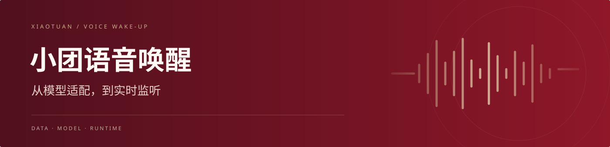
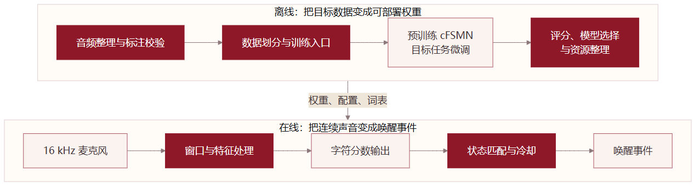

<a href="https://woaijieyang.github.io/0002_Barging-in_xiaotuan_yuyinhuanxing/">在线阅读</a> &nbsp; / &nbsp; <a href="#现场演示">现场演示</a> &nbsp; / &nbsp; <a href="小团语音唤醒_本地实现与工程能力详解.md">技术文档</a> &nbsp; / &nbsp; <a href="https://github.com/woaijieyang/0002_Barging-in_xiaotuan_yuyinhuanxing/raw/refs/heads/main/downloads/xiaotuan-reader.zip">交互阅读包 ↓</a>

这个项目围绕一句“小团小团”展开：把已有的语音模型接到持续的麦克风输入上，让识别结果成为后续交互的入口。我以 [ModelScope 的字符级 cFSMN](https://modelscope.cn/models/iic/speech_charctc_kws_phone-xiaoyun) 为起点，主要完成数据处理、目标微调、模型接口适配和本地监听流程的实现。

## 现场演示

### 一段现场交互

https://github.com/user-attachments/assets/03e47ff2-b7bf-4b1b-bcbd-92f4bfeeeafb

[▶ 观看视频](https://github.com/user-attachments/assets/03e47ff2-b7bf-4b1b-bcbd-92f4bfeeeafb) · 1 分 42 秒

另一个现场片段 · 13 秒

https://github.com/user-attachments/assets/8d169a57-31b6-458a-b28c-f530791fc4c6

## 实现路径

### 整理声音

我将音频转换、增强和清单生成写成了连续的处理步骤。录音先统一为16 kHz、16 bit、单声道WAV；短于1.05秒的片段随机分配前后补齐时间，较长片段则随机叠加0—3层背景噪声，变化噪声类型、持续时间和插入位置。文件转换由进程池并行处理，输出沿用统一的编号规则，方便后续配对。

接着按文件名排序音频，与逐行文本配对。脚本检查两边数量，发现缺项便停止处理，再将标注转换为字符序列，生成音频索引与标签清单。训练、验证和测试按8∶1∶1划分，并固定划分种子。这样，文件格式、样本编号和标签组织都有明确的处理位置，准备新一批数据时也可以沿用同一套脚本。

### 适配模型

我选择保留预训练模型的四层cFSMN和2599类字符输出，用“小团小团”的目标数据微调权重。前端沿用80维Fbank，将相邻5帧拼成400维输入，并每3帧取一次。保留这套结构和输入约定，才能继续利用基座已有的声学表征。

训练入口将学习率从0.001调为0.0001，预处理批大小从256调为64，并把训练与评估分成两个调用模式。脚本还设置了3个checkpoint的平均流程，保存评分文件，供关键词阈值选择时查看。模型、配置、关键词文件和转换资源随后集中到部署目录，监听程序从这里读取，减少训练路径与运行路径交错带来的问题。

### 接入设备

运行部分由模型引擎和音频模块协作。模型引擎负责特征处理、权重加载和字符输出；音频回调维护最近1.5秒的声音窗口，写入新数据后通知主循环推理。导出版本每100毫秒接收一块音频，监听版本为200毫秒。采集与计算分开后，设备有没有收到声音、模型有没有产生输出，可以分别观察。

我还围绕框架接口编写了输出包装，尝试JIT导出，并保留动态图调用版本。判定部分按“小—团—小—团”的顺序推进状态，匹配后进入1秒冷却，再清理缓冲。这里需要同时处理特征形状、返回值、窗口重叠和状态重置，单独跑通一个模型调用只是其中一步。

## 系统全貌

## 排错笔记

下面从三种容易遇到的现象说起：说了唤醒词没有反应、只说一次却连续触发，以及换一台电脑后程序无法启动。

### 没有回应

说了“小团小团”，终端却一直没有唤醒提示，我会先确认声音有没有录进去。最直接的办法是保存几秒麦克风录音，回放听一下。如果录音无声、声音很小，或者录到的是另一只麦克风，就先检查输入设备和音量。终端显示“监听开始”，只能说明程序进入了监听流程，不能据此判断录音是否正常。

如果录音清楚，下一步就看识别程序有没有报错。监听程序会把推理异常也返回成“未唤醒”，所以外面看到的仍然是没有反应。排查时应先输出原始错误，确认问题发生在音频处理、模型加载还是模型调用。比如，错误指向输入尺寸时，就对照训练时的音频处理步骤检查部署前端；错误指向模型文件时，就检查实际加载的路径。

处理后，先用刚才保存的同一段录音测试。这样每次送进去的声音相同，才能判断改动是否有效。文件测试能正常给出结果，再接回麦克风，检查现场输入。把这两步分开，就不会一边改代码，一边又被音量、距离或环境声的变化干扰。

### 重复唤醒

另一种情况是只叫了一次，程序却连续输出两次唤醒。这里要先看程序是否重复处理了同一段声音。监听版本保留最近1.5秒的录音，每200毫秒更新一次，因此相邻两个窗口中有约1.3秒的内容重叠。同一句“小团小团”可能同时出现在几个窗口里。

代码已经加入1秒冷却和缓冲清理。出现重复触发时，我会核对一次唤醒之后，这两步是否执行，以及上一次的识别进度是否已经清零。如果旧录音仍被再次用于推进识别，就需要记录音频已经处理到的位置，让后续判断只使用新到达的部分，而不是不断延长冷却时间。

验证时可以只说一次，随后保持几秒安静，观察是否只产生一个事件；再等冷却结束，说第二次，检查新的呼叫是否仍能被识别。这两个检查分别对应“没有重复触发”和“没有把下一次有效呼叫挡住”。

### 换机报错

程序在原电脑上能启动，换到另一台设备却提示找不到模型文件，通常应先查路径。训练脚本和部署脚本可能仍指向原来的工作目录；文件虽然复制过去了，程序读取的却还是旧位置。应当先打印它实际使用的路径，再逐项检查权重、配置和关键词文件是否存在、是否非空。

处理这类问题时，部署入口应从统一的模型目录查找资源，并在开始监听前检查文件是否齐全。如果文件已找到但仍然加载失败，再看依赖版本和报错所指的接口。先用本地录音验证模型加载与识别，再测试麦克风接入，便于分清是模型环境的问题，还是音频设备的问题。

## 深入阅读

- [设计、编程与Debug工作说明](小团语音唤醒_本地实现与工程能力详解.md#contribution)
- [网络结构与参数计算](小团语音唤醒_本地实现与工程能力详解.md#network)
- [部署接口与调试案例](小团语音唤醒_本地实现与工程能力详解.md#debug)
- [完整参数手册](小团语音唤醒_本地实现与工程能力详解.md#dictionary)

[在线阅读完整技术文档](https://woaijieyang.github.io/0002_Barging-in_xiaotuan_yuyinhuanxing/)，可直接使用参数搜索、图表放大和结构计算。也可以下载上方阅读包，解压后打开其中的 HTML 离线阅读。
