# 小团语音唤醒：从模型适配到实时监听

技术方案与工程实践 · 2026 年 10 月

<a id="design"></a>

## 整体设计与关键参数

我围绕“小团小团”的唤醒需求，设计并实现数据准备、训练调用和本地监听流程，完成目标任务的模型适配。项目复用预训练声学能力，我的工作重点是让数据、模型和音频设备按同一套输入输出约定连接起来，并在出现问题时能够分层检查。

**整体方案有三个关键选择：保留声学基座、建立数据处理流程、拆分运行职责。** 网络采用80维Fbank、400维输入、四层cFSMN和2599类字符输出，结构与上游一致。适配发生在目标数据、训练设置、模型权重与部署接口上。

- **保留字符级基座。** 继续使用已有的语音表征和字符输出，用目标数据微调权重；这样能将开发重点放在“小团小团”的任务适配上。
- **把数据处理做成流程。** 将格式转换、随机补齐、噪声叠加和清单校验串联起来，让训练输入有统一格式，也让文件与标签问题更早暴露。
- **按职责组织运行模块。** 将模型加载与计算、回调采集、窗口管理和状态匹配分开组织，便于检查接口、理解时序和定位异常。


*图1｜从离线数据到在线事件，红色模块表示项目中的工程组织和适配重点。*

[Mermaid图源](figures/overview.mmd)


<a id="contribution"></a>

## 我的编程能力、Debug 能力与调试方法

### 设计选择：复用基座，适配任务

我负责把预训练语音模型适配到“小团小团”的唤醒需求，并组织从数据准备到本地监听的实现流程。我保留四层cFSMN和2599类字符输出，以复用已有声学表征；围绕目标数据调整训练设置，将模型计算、音频采集和唤醒判定分开处理。这一设计让各模块的输入输出可以单独检查，也方便定位问题。我的贡献主要落在数据工具、训练配置、接口适配和运行流程上。网络结构沿用基座，目标任务通过权重微调和关键词配置进行适配。

### 编程实现：数据处理与训练入口

数据处理上，我将格式转换、短音频随机补齐、背景噪声叠加和并行导出串成处理流程，再用排序、编号、音频与文本数量校验生成字符级训练清单。校验放在训练之前，是为了尽早发现缺文件和标签数量不符的问题；语义是否配对还需抽查。训练脚本集中组织配置、训练与评估入口，将学习率调为0.0001、预处理批大小调为64，并保留不同轮数设置。这样可以明确一次运行使用什么输入、产生什么文件，也为比较版本提供依据。

### 模块组织：分开采集与模型计算

部署时，我用模型引擎集中处理资源加载、特征和判定，用音频模块接收回调、维护1.5秒窗口，再通过事件通知主循环推理。采集回调不直接承担整段模型计算，便于分别观察输入与推理状态。我围绕模型返回值尝试了输出包装、JIT导出和动态图回退，并加入触发后的冷却与缓冲清理。这部分工作需要同时理解文件依赖、张量形状、调用签名和线程时序。监听版本的200毫秒是回调间隔，实际响应速度还要结合推理耗时和设备测试判断。

### Debug实践：从现象寻找原因

说了唤醒词没有反应时，我会先录音回放，确认声音是否进入程序；录音清楚后，再检查识别过程中的错误。出现重复唤醒时，就查看同一句话是否留在多个窗口中，冷却和清理是否执行。这样的排查与我的模块划分对应：采集问题查音频模块，计算问题查模型引擎，重复事件查状态管理。进一步分析发现，输入格式、字符编号和异常返回方式都可能影响结果。对这些问题，需要分别确认原因，再用同一段录音检查改动是否有效。

### 调试方法：保留样例，核对改动

语法或库接口报错，我会先自己阅读错误信息和相关调用；仍然找不到原因时，再请AI结合必要的代码与预期行为分析。我会核对建议改了哪里、为什么要改，以及它是否改变音频处理或唤醒条件。例如，修正调用参数和跳过归一化可能都让报错消失，但对模型输入的影响不同，不能直接照搬。保留原失败录音，修改后再测试正常呼叫、安静背景和连续呼叫，是我在项目复盘中补充的验证步骤。判断一次修改是否合适，要看这些具体结果。


### 关键参数与版本对照

| 位置 | 项目设置 | 相对基座的变化与作用 |
|---|---|---|
| 声学输入 | 16 kHz 单声道；25 ms 窗、10 ms 步长；80 维 Fbank | 保持输入契约，使预训练权重有可复用的意义 |
| 上下文与降帧 | 左 2＋当前 1＋右 2；每 3 帧取一次 | 输入宽度 400，网络时间步约 30 ms |
| 网络主体 | 4 层；线性维度 250；投影维度 128；左 10、右 2 抽头 | 保留字符级轻量基座，目标词通过标签和解码定义 |
| 学习率 | `0.001 → 0.0001` | 用较小更新幅度进行目标微调 |
| 数据处理器批大小 | `256 → 64` | 调小每批录音条数；与另一个未被该路径使用的通用批大小字段区分 |
| weight decay | `0.0001 → 0.00001` | 参数收缩约束减弱；与较小学习率共同构成该版微调设置 |
| 训练轮数 | 保存配置与 v1 为 55；v2 为 10 | 属于不同版本的上限设置，实际过程依据 epoch 记录解释 |
| 平均与阈值 | 平均数量配置为 3；关键词阈值文件为 0.50 | 平均数量是调用设置；0.50在两条解码路径中的含义见第10章 |
| 运行窗口 | 1.5 s 窗口、1 s 冷却；监听版本200 ms回调，导出版本100 ms | 分别保留两个版本设置，区分更新频率与实际响应时间 |

### 阅读路线

- [01｜一声“小团小团”，系统究竟要完成什么](#story)
- [02｜为什么使用预训练基座，哪些是我的工作](#foundation)
- [03｜从音频文件到可以训练的数据](#data)
- [04｜Fbank、上下文拼接与 CMVN 如何协同](#frontend)
- [05｜全局网络结构：保留了什么，如何理解每层](#network)
- [06｜约 75 万参数如何计算，计算量与延迟有何区别](#parameters-math)
- [07｜字符词表与 CTC：为什么不需要逐帧标字](#ctc)
- [08｜一次训练更新怎样发生，参数怎样真正生效](#training)
- [09｜训练过程与模型选择](#history)
- [10｜离线解码与运行时状态匹配为什么要分别解释](#decode)
- [11｜把模型接到持续音频上：模块、缓冲与时序](#runtime)
- [12｜模型加载与导出：接口适配比文件搬运更重要](#deployment)
- [13｜排错笔记：从没有回应开始](#debug)
- [14｜调试之后：把改动验证清楚](#method)
- [15｜评估怎样读，哪些数字可以支持结论](#evaluation)
- [16｜现场演示：把运行场景放回读者眼前](#demo)
- [17｜参数手册：查清一个数值如何影响整个系统](#dictionary)
- [18｜工作总结、后续完善与实现来源](#sources)

<a id="story"></a>

## 01｜一声“小团小团”，系统究竟要完成什么

设想机器人正在等待交互。麦克风接收到的是连续变化的声音，不是“小”“团”这几个字。系统需要把声音转为数字，从短时间窗口中提取特征，让网络给每个时间步打分，再判断这些分数是否构成完整的目标词。最终输出应当是一次明确的唤醒事件，供后续交互模块使用。

这里有两条不同的时间线。**离线训练改变模型参数，在线推理使用已经确定的参数。** 采集到一段新声音，不会让监听程序自动学习；训练好的网络也不会自动完成麦克风接入、重复事件抑制或机器人业务调度。这些连接工作正是本地化部署的重要部分。

项目流程已经把数据转换、清单生成、训练评估和监听入口分开。阅读这份文档时，可以先跟着数据走一遍，再回到网络内部理解数学细节。遇到一个参数，不必立即背下数值，先问：它控制哪一步，单位是什么，改动会传到哪里？

| 术语 | 一句话理解 | 本项目中的例子 |
|---|---|---|
| 采样点 | 声音某一瞬间的数值 | 每秒 16,000 点 |
| 基础帧 | 一小段重叠的声音窗口 | 每窗 400 点，下一窗前进 160 点 |
| 网络时间步 | 送进模型的一组特征 | 5 帧拼接，再每 3 帧取一次 |
| token | 网络输出的一个离散符号 | 字符“小”“团”及 blank |
| logit | 未归一化的类别分数 | 可以为负，各类之和不要求为 1 |
| 概率 | softmax 后的帧级分布 | 同一帧的 2599 类概率之和为 1 |
| checkpoint | 保存的模型状态 | 可训练权重，也可包含 CMVN 等 buffer |
| 阈值 | 某个判定步骤的接受门槛 | 必须说明是帧概率还是关键词候选分数 |

<a id="foundation"></a>

## 02｜为什么使用预训练基座，哪些是我的工作

小规模目标数据适合教模型辨认特定短语和目标设备的声音，却不足以重新覆盖中文语音中的全部发音变化。预训练声学基座已经从大量语音中学习到一定的声音表示，复用它相当于从已有的听觉经验出发，再对目标任务做调整。这里复用的是模型结构和已有权重，并不意味着数据准备、训练流程、设备接口或唤醒事件管理会自动完成。

训练调用在没有给出有效恢复路径时，进入 ModelScope 近场训练器的 `train/base.pt` 加载分支。它与用于识别上游特定词的 finetune 权重不是同一个资产。权重对照分析显示，目标模型与基座有29个状态张量不同。权重变化反映任务适配的结果，识别效果则通过后续评估与设备测试衡量。

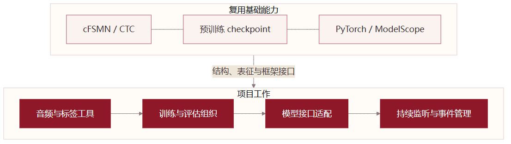

*图2｜网络方法与预训练资产保留来源；贡献落在目标适配和工程流程。*

[Mermaid图源](figures/ownership.mmd)

| 内容 | 采用方式 | 在本项目中的用途 |
|---|---|---|
| cFSMN 与字符 CTC 建模 | 复用公开方法和实现 | 建立轻量声学识别能力 |
| 上游 base checkpoint | 复用预训练参数后进行目标适配 | 降低从零训练的成本，保留已有语音表征 |
| PyTorch、ModelScope | 复用框架和训练组件 | 张量运算、模型构建与训练评估 |
| 音频整理、标注清单、训练入口 | 项目流程实现与配置 | 将项目数据接入可重复运行的流程 |
| 模型包装、监听入口、状态与缓冲管理 | 任务适配与迭代 | 将离线资源接到持续音频输入上 |
| 原生转换与运行组件 | 复用对应工具 | 网络格式转换、量化和资源打包；内部细节以公开接口为准 |

项目设计的价值在于把这些部分连接为有明确输入输出的系统。系统方案围绕任务适配与工程组织展开，声学基座及复用工具的来源见文末。

<a id="data"></a>

## 03｜从音频文件到可以训练的数据

数据准备首先解决格式统一，再解决内容与标签的对应。转换脚本将 MP3 统一为 **16 kHz、16 bit、单声道 WAV**，采用进程池并行处理文件。转换与增强在CPU进程中完成，NumPy处理数值运算，进程池负责并行分配文件。

预处理按时长分两路。短于 1050 ms 的录音补齐到目标长度，补齐部分在前后随机分配，并在静音、粉噪声和棕噪声之间选择。较长录音随机叠加 0—3 层背景噪声，变化噪声种类、持续时间和插入位置。这样产生的是位置和背景条件的变化，目的在于降低样本过于单一的问题。

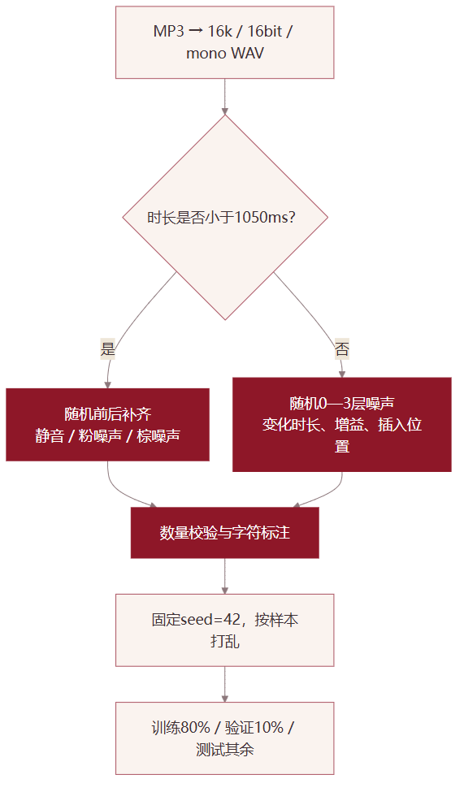

*图3｜短录音补齐位置，长录音变化背景，再统一生成标签与清单。*

[Mermaid图源](figures/data.mmd)

粉噪声通过频域幅度乘以约 `1/sqrt(f)` 形成，功率谱随频率约按 `1/f` 衰减；棕噪声幅度约乘 `1/f`，对应功率约 `1/f²`。这解释了为什么两种噪声更偏向低频。噪声增益 `-25～-50 dB` 是对生成噪声施加的衰减，**没有先按语音 RMS 归一化，因此不能直接称为实际 SNR**。峰值归一化同样不同于感知响度归一化。

清单脚本按文件名排序音频，读取非空文本行，检查数量一致，生成唯一 ID，并将文字变为按字符分隔的标注。随后固定种子 42，合并正负样本、随机打乱，按 8∶1∶1 写出训练、验证和测试清单。`wav.scp` 保存 ID 与路径，`text` 和 `trans.txt` 保存 ID 与标签；它们不是三个功能相同的文件。

数量校验负责发现缺项，抽听和编号检查负责确认内容对应。样本按随机方式划分；说话人和原始语句是否跨集合，还需要按来源分组检查。同一原始语句衍生的增强版本应放在同一集合中。

语音生成服务以CosyVoice为基础，结合音色缓存、推理锁和流式输出接口，辅助构建合成样本。数据整理时分别记录合成音频与真人采集的来源，样本条数、原始语句数量和参与人数也分别统计。

<a id="frontend"></a>

## 04｜Fbank、上下文拼接与 CMVN 如何协同

16 kHz 表示一秒内有 16,000 个采样点。25 ms 窗口包含 `16000×0.025=400` 点，10 ms 步长前进 `16000×0.010=160` 点，因此相邻窗口重叠 240 点。窗口较长有利于观察频率成分，步长较小有利于跟踪发音变化，两者控制的是不同事情。


*图4｜先观察短时频率成分，再把它压缩成模型使用的特征。*

[Mermaid图源](figures/frontend.mmd)

Fbank 对窗口内波形加窗，计算频谱与功率，再通过 Mel 滤波器组汇聚并取对数，得到 80 个值。训练前端使用 Kaldi Fbank 的 Hamming 窗。它不等于随意调用一个 MelSpectrogram：FFT、Mel 定义、预加重、幅度尺度、边界处理和加窗方式不同，都可能改变特征分布。

每个基础帧再与前 2 帧、后 2 帧连接。连接是把数字并排放在一起，不是求平均：`80×(2+1+2)=400`。随后每 3 帧保留一个结果，网络时间步约为 30 ms。上下文处理器在左边界复制起始特征，在右边界丢弃缺少未来上下文的最后 2 帧。因此一秒录音的典型形状变化是：98 个基础帧 → 96 个拼接帧 → 32 个网络时间步；这与另一种末尾补齐实现的帧数不同。

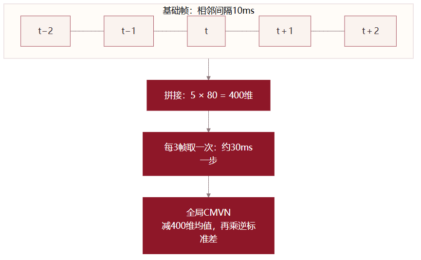

*图5｜拼接改变宽度，降帧改变时间步长，CMVN改变数值尺度。*

[Mermaid图源](figures/context.mmd)

模型在网络前执行全局 CMVN：`x_normalized=(x−mean)×istd`。模型checkpoint 中 `mean` 和 `istd` 各有 400 项，以 buffer 形式保存。归一化参数随checkpoint一同保存。 重建部署模型时，既要把这些数值加载进去，也要保证计算路径真正调用该模块。

将当前 1.5 秒窗口单独归一化会使用随窗口变化的均值与方差，和训练时的固定全局统计不是同一变换。它可以作为新的实验设计，但不能直接写成对缺失文件的等价替代。前端一致性应从同一段波形开始，逐级比较基础特征、拼接结果和归一化输出。

<a id="network"></a>

## 05｜全局网络结构：保留了什么，如何理解每层

网络输入记为 `[B,T,400]`，其中 B 是本批录音数量，T 是补齐后的网络时间步数。前两层将特征从 400 维映射到 140 维，再映射到 250 维并进行 ReLU。中间串联四个记忆块，最后通过 `250→140→2599` 的两次仿射映射得到字符分数。

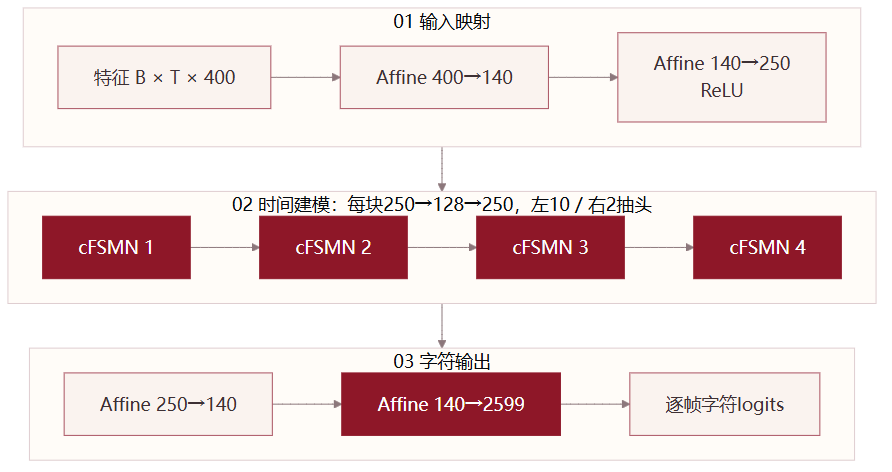

*图6｜结构与上游保持一致；训练改变权重，不改变2599类输出定义。*

[Mermaid图源](figures/network.mmd)

每个记忆块先把 250 维表示投影到 128 维，在这 128 个通道上分别做时间滤波，再恢复到 250 维并激活。投影层控制记忆计算的宽度。左滤波的 10 个抽头包含当前帧和 9 个过去帧；右滤波的 2 个抽头访问之后两个网络步。滤波是按通道进行的，不是让每个通道与所有其他通道做一组完整时间卷积。

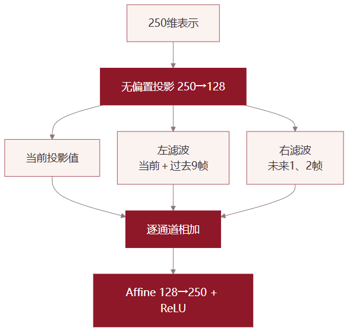

*图7｜左10抽头包含当前帧；右2抽头引入未来信息。*

[Mermaid图源](figures/memory.mmd)

用符号表示，一个通道的记忆输出可以理解为：当前投影值，加上左侧若干帧的加权和，再加上右侧若干帧的加权和。各抽头的权重由训练学习，不是平均分配。网络由多个块串联，因此后面的块看到的表示已经包含前面块汇聚的上下文。

这份实现保留上述层数和维度，目标适配通过参数更新和关键词解释实现。我将设计重点放在特征一致性、目标数据与模型接口的衔接上，让轻量声学基座成为整个监听流程中可检查、可替换的计算模块。

<a id="parameters-math"></a>

## 06｜约 75 万参数如何计算，计算量与延迟有何区别

仿射层从 a 维映射到 b 维时，如果带偏置，参数量为 `a×b+b`。无偏置投影层只有矩阵项。四个记忆块的每块参数由投影、左右逐通道滤波、恢复映射及其偏置组成。

| 部分 | 计算 | 参数数量 |
|---|---|---:|
| 输入映射 | `400×140+140` | 56,140 |
| 中间映射 | `140×250+250` | 35,250 |
| 一个记忆块 | `250×128+128×(10+2)+128×250+250` | 65,786 |
| 四个记忆块 | `65,786×4` | 263,144 |
| 输出前映射 | `250×140+140` | 35,140 |
| 字符分类层 | `140×2599+2599` | 366,459 |
| **可训练参数合计** | 以上各项之和 | **756,133** |
| CMVN 状态 | 均值 400＋逆标准差 400 | 800 个非训练 buffer 元素 |

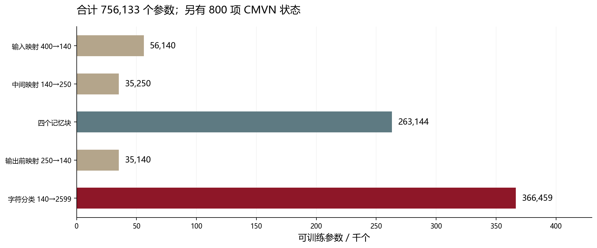

*图8｜按模型权重形状计算；CMVN的800个buffer元素另列，不计入可训练参数。*

整个 checkpoint 的张量元素总数为 756,933，但其中 800 项是归一化状态，不能全部称为可训练参数。分类层占据较大比例，因此轻量网络也不意味着最后一层可以忽略。保留大字符词表的代价，是它比少数类别的输出层更大；本项目以继续复用字符基座为选择。

理论未来特征跨度包含两部分：前端拼接需要后 2 个基础帧，即 20 ms；四层网络各向未来使用 2 个 30 ms 时间步，即 `4×2×30=240 ms`。合计为 **260 ms 的理论未来特征跨度**。它不包含采集分包、特征计算、线程等待、模型运算、判定和业务响应，也不是实测端到端延迟。

**结构计算实验。** HTML版提供投影维度、上下文拼接和未来抽头的交互计算器。固定其余网络宽度时：可训练参数量＝输入维度×140＋140＋140×250＋250＋4×[250×P＋P×(10＋R)＋P×250＋250]＋250×140＋140＋140×2599＋2599；CMVN状态元素＝2×输入维度；理论未来跨度＝前端未来帧数×10ms＋4×R×降帧间隔×10ms。默认P=128、R=2时，可训练参数756133，CMVN元素800，理论未来跨度260ms。

计算器固定其余网络宽度，展示投影维度、右抽头和降帧设置的结构影响。它用于比较结构成本，识别率通过评估确定。更窄可能降低参数量，但是否损失区分能力需要数据验证；减少未来上下文也需要重新检查检测效果与边界行为。

<a id="ctc"></a>

## 07｜字符词表与 CTC：为什么不需要逐帧标字

一段“小团小团”可能持续一秒，也可能持续两秒。人工通常只知道整句文字，不知道每个字在第几帧开始。CTC 将这种不确定对齐放进训练目标：网络逐帧输出分数，训练时把能够折叠为正确字序列的路径概率合并起来。

CTC 的折叠先合并连续重复符号，再删除 blank。例如“blank、小、小、blank、团、小、团”折叠为“小团小团”。如果目标包含连续两个相同字，二者在路径中至少需要一个 blank 隔开，否则会合并成一个字。blank 表示这一帧不输出字符，它也不等同于静音检测。

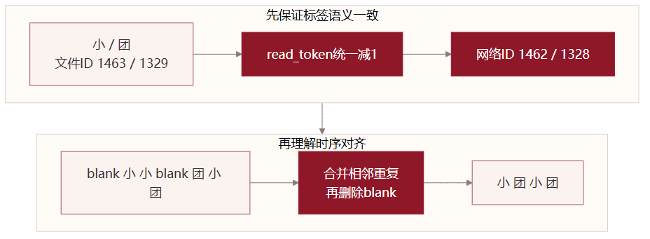

*图9｜文件编号减1形成网络索引，路径折叠恢复目标字序。*

[Mermaid图源](figures/ctc.mmd)

字符词表中的“小”为 1463，“团”为 1329，blank 为 1；该训练器读取时统一减 1，因此实际网络索引为 **1462、1328、0**。目标标签顺序是 `[1462,1328,1462,1328]`。文件编号与张量索引差一位，模型仍可能正常执行，但解释出来的字符会错位，这是一类典型的“没有异常但语义不对”的问题。

上游训练损失对 logits 使用 log-softmax 后交给 CTC。logit、帧概率和最终关键词候选分数要分清：它们分别服务于网络输出、帧级分布和关键词接受判断。对某一帧全部类别取平均，会丢掉词序与对齐信息，不能替代关键词解码。

<a id="training"></a>

## 08｜一次训练更新怎样发生，参数怎样真正生效

数据先按清单读取，经过长度过滤、必要的重采样、Fbank、训练增强、随机混合、上下文拼接和降帧，再按批打包并补齐长度。前向得到逐帧字符分数，CTC 计算损失，反向传播得到梯度，裁剪之后由 Adam 更新参数。验证阶段关闭随机增强与打乱，生成用于比较模型状态的损失。

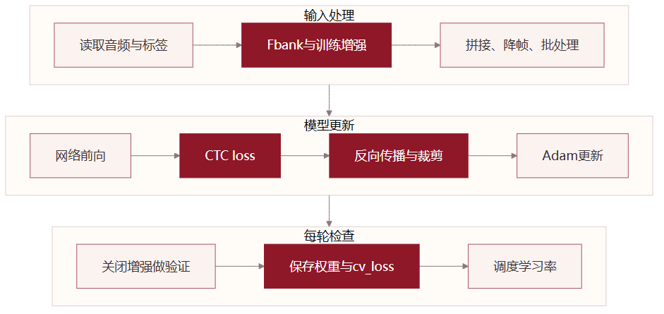

*图10｜输入处理、反向更新和验证选择是不同职责。*

[Mermaid图源](figures/training.mmd)

项目将数据处理器批大小设为 64，意味着每批最多打包 64 条录音。它与旧版 FunASR 的长度预算批次不是同一语义。专用训练器中的 PyTorch DataLoader 使用 `batch_size=None`，因为下游数据处理器已经形成批次；因此另一个 `batch_size_per_gpu=256` 字段虽然仍在配置里，并不控制这条路径的实际打包数量。

学习率从上游 0.001 调为 0.0001，意图是在已有声学表征上做更小步幅的更新。weight decay 从 0.0001 调为 0.00001，约束实际上减弱。两者调整改变了优化行为，是否更适合目标数据必须结合验证结果，而不是仅用“降低过拟合”概括所有参数修改。

### 配置写出来，还需要追到执行位置

ModelScope近场训练器的参考实现使用自己的训练循环：直接构造 Adam 和 ReduceLROnPlateau，每轮执行验证、保存 checkpoint，并将 `cv_loss` 传给学习率调度器。它没有执行通用 `train.hooks` 列表，所以添加 EarlyStoppingHook 不等于已经实现自动早停。

同样，训练器用同一个转录索引查找训练与验证清单中的 ID，并未读取另传的 `cv_trans_data`。把训练、验证标签放在一个查询索引里，并不等于把验证音频用于训练；真正决定进入哪一部分的是各自的样本清单。这个接口语义比“文件是否合并”更重要。

参数是否生效取决于实际调用路径。训练记录需要同时保存框架版本、参数值和使用的入口，便于复现实验与比较不同配置。

<a id="history"></a>

## 09｜训练过程与模型选择

训练设置经历了55轮上限与10轮上限两个版本。训练记录包含 **44个观测点，覆盖epoch 0—48**；曲线在没有记录的轮次处断开，保留各轮已有的损失与学习率。

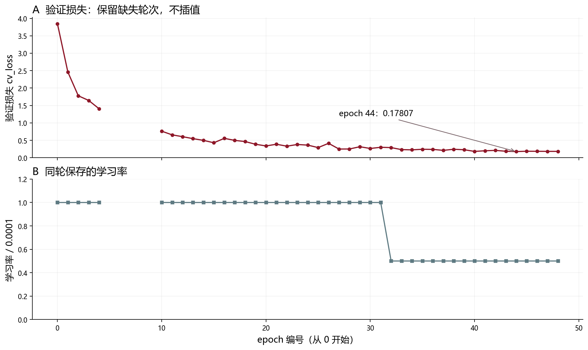

*图11｜44条有效记录覆盖epoch0—48；两幅图分别展示验证损失与学习率，不使用双Y轴。*

训练记录中，epoch 44 的验证损失为约 0.17807；epoch 40 和 48 分别约为 0.18267、0.18329。后期学习率记录为 0.00005。验证损失描述优化进程；目标场景的漏检与误触发则在独立评估中观察。

评估入口设置 `average_num=3`，按验证损失选择权重进行算术平均。对照分析显示，`avg_3.pt` 与第44、40、48轮权重的平均结果不同，平均所用轮次还需要在模型选择记录中补充。记录选轮信息，可以把训练过程、平均模型和评估结果对应起来。

对工程实践而言，这说明模型产物管理应和训练代码同等重视。一次运行至少保存配置、框架版本、数据清单标识、实际使用的权重与评估输出。这样下一次接入设备时，才能知道正在测试的是哪一版模型。

<a id="decode"></a>

## 10｜离线解码与运行时状态匹配为什么要分别解释

上游评估器采用 CTC 前缀搜索。它先保留每帧全词表的 top-3，再过滤概率不超过 0.05 或不属于相关 token 的项；更新 blank 与非 blank 结尾的前缀概率，保留 top-20 路径，再判断是否出现目标字符序列。

监听版本采用更简单的方案：逐帧取 argmax，若非 blank 且概率超过阈值，并与当前位置期待的字符一致，就将状态指针加一；到达四个字符后产生事件。这是基于帧级输出的顺序匹配器，**不能直接称为与前缀搜索等价的完整 CTC 解码器**。

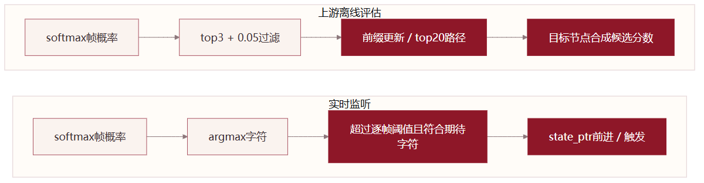

*图12｜离线前缀搜索与本地逐帧状态匹配需要分别校准。*

[Mermaid图源](figures/decode.mmd)

两种路径的阈值含义不同。上游候选分数按目标节点概率的乘积开平方计算；运行时匹配器比较的是单帧类别概率。即使都从关键词文件读到 0.50，也不代表同一个工作点。离线阈值应在离线解码路径上评估，实时阈值应在实际监听路径上重新校准。

例如四个目标节点概率都是 0.9，则上述候选分数为 `sqrt(0.9⁴)=0.81`。0.81 既不是“81%准确率”，也不是每个字符都达到0.81。它只是该评分规则下的候选数值。关键词越长，分数尺度也可能变化，因此不能不加区分地横向比较不同长度的词。

简化状态机还要考虑错误字符、重复峰值、跨窗口重复音频和时间跨度。监听逻辑在不匹配字符出现时没有完整的回退策略，时间重置依赖主机墙钟，而非音频帧时间。这些位置适合通过构造固定输入逐项验证，而不是一开始就重新训练网络。

<a id="runtime"></a>

## 11｜把模型接到持续音频上：模块、缓冲与时序

系统将运行职责分给三个部分：部署准备负责整理模型与配置，`KWS_Engine` 负责前端、权重和判定，`AudioHAL` 负责设备输入与主循环协调。这种拆分让音频设备问题、模型问题和业务判定问题可以分别检查。

监听版本的采集回调每收到 3200 点数据，就把长度 24000 的缓冲向左移动，将新声音放到末尾，再设置线程事件通知主循环。在16 kHz下，这对应200 ms回调和1.5秒窗口；导出版本使用1600点回调，即100 ms。主循环取整个窗口提特征并推理。`np.roll` 实现的是数组滑动，每次会移动数据；它不等同于只改变读写指针的零拷贝环形队列。

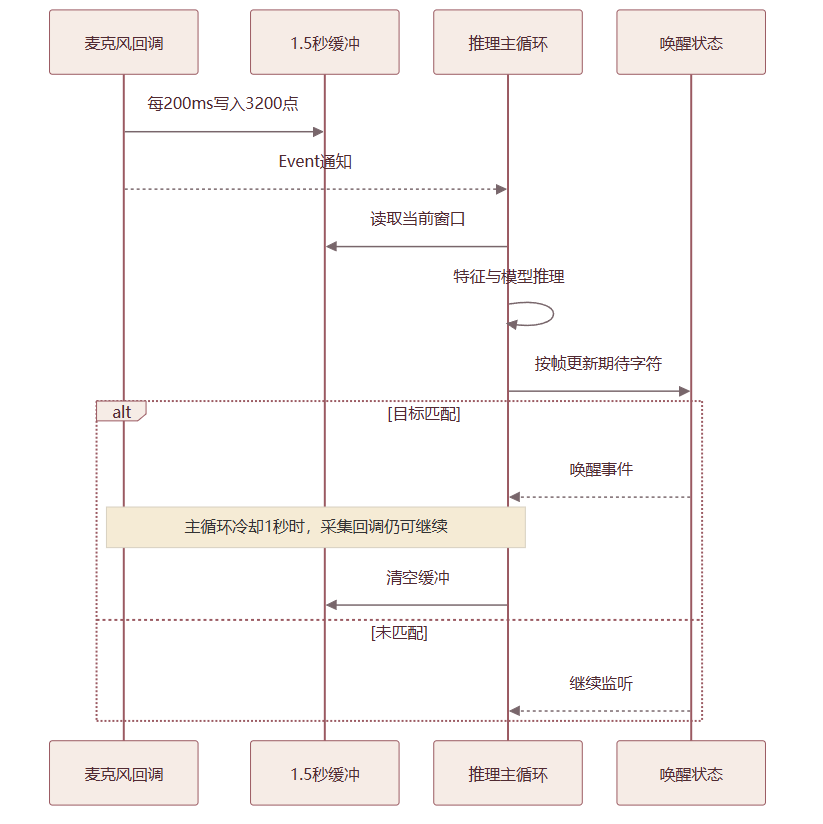

*图13｜图示监听版本：200ms回调、1.5s窗口；导出版本回调为100ms。这些数值均不是实测响应延迟。*

[Mermaid图源](figures/runtime.mmd)

事件可以让主循环等待采集更新，但 Event 只有“已设置/未设置”的状态，不记录通知次数。如果推理慢于采集，多次通知可能合并。缓冲由采集线程写入、推理线程读取，需要通过一致的音频副本或适当同步来协调访问。

触发后主循环休眠 1 秒并清空缓冲，目的是减少残留语音重复输出。休眠期间采集回调仍可能运行，因而冷却是判定策略，不是停止采样。窗口重叠也意味着同一段音频可能多次进入模型，需要将解码状态与绝对音频时间对齐，避免重复累计相同字符。

下面用伪代码说明各阶段的职责：

```text
采集阶段：接收新音频 → 更新窗口 → 通知推理阶段
推理阶段：读取一致的音频副本 → 检查前端维度 → 获取字符分数
判定阶段：只处理需要推进的时间范围 → 更新目标词状态
触发阶段：输出一次事件 → 执行冷却策略 → 清理对应状态
诊断阶段：分别记录正常拒绝、模型异常与成功触发
```

其中，一致的音频副本、按新时间范围推进判定和独立异常计数，是后续完善的重点，分别对应并发读取、重复判定和错误定位。

<a id="deployment"></a>

## 12｜模型加载与导出：接口适配比文件搬运更重要

部署脚本首先整理 checkpoint、配置、关键词文件和网络转换文本，再重建模型、注入权重，尝试包装输出并进行 JIT trace。另一份监听脚本放弃强行静态化，改用动态图调用。两条路径体现了对框架接口和可运行方式的探索，但它们仍需要分别验收。

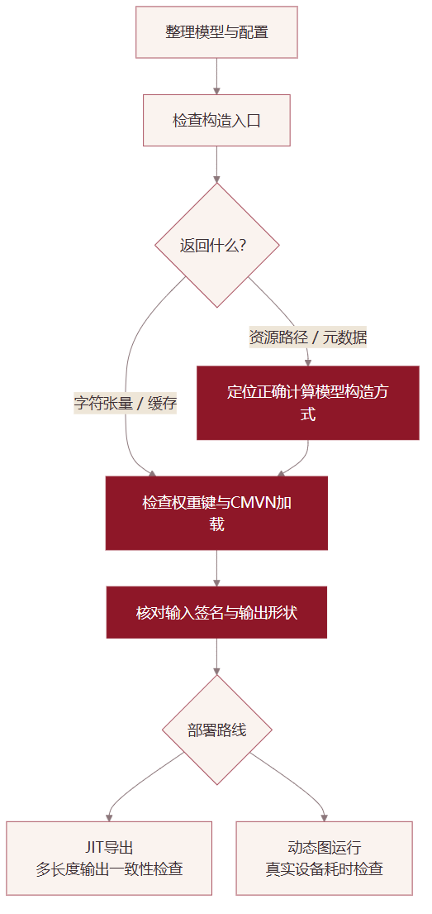

*图14｜默认资源描述器、真实计算模型与导出产物不能混为一谈。*

[Mermaid图源](figures/deployment.mmd)

模型仓库的默认入口可能服务于原生资源流水线，只返回模型目录和配置路径。公开实现中的 `FSMNDecorator` 在 `training=False` 时走的就是元数据分支；训练器会用相应构造方式取得内部计算模型。返回字典并不一定意味着字典里有 logits，这解释了为什么“加载模型成功”之后仍可能无法直接拿来做张量推理。

实际计算模型接收特征和可选缓存，返回输出张量与缓存元组。包装器需要准确知道输入签名和返回结构，不能看到任意 Tensor 就认为找到了正确的字符输出。一个长度张量也可能被误传给期望缓存的位置，必须通过接口定义而不是变量名猜测。

`load_state_dict(strict=False)` 会允许缺失或多余的键，便于某些兼容场景，但调用没有抛异常不代表权重完整加载。应检查返回的 missing/unexpected keys、实际加载比例，以及 CMVN 与骨干参数是否进入正确层。移除 `module.` 前缀同样只是处理一种命名差异，不保证外层包装已经对齐。

JIT trace 记录示例输入执行过的计算路径，不能仅用 `[1,50,400]` 的一个随机输入证明所有录音长度与状态分支都适用。需要比较导出前后同一音频的输出，并测试短、长、静音与边界输入。动态图回退降低了静态导出接口的要求，性能是否足够仍以设备测量为准。

原生部署链路复用网络格式转换、16bit量化和资源打包工具，负责生成目标后端可读取的资源。PyTorch监听是另一条运行路线，两条路线分别检查前端、词表及输出的一致性。

<a id="debug"></a>

## 13｜排错笔记：从没有回应开始

把训练好的模型接到麦克风后，问题往往不像训练日志那样直观：程序已经启动，说了唤醒词却没有提示；有时只叫了一次，又会连续触发。此时需要先弄清楚，声音停在了哪一步。我将模型引擎和音频采集分开组织，正是为了能分别检查录音、模型计算和唤醒判定。导出路线与监听路线围绕不同的调用方式展开，接口适配贯穿其中。

下面结合现有实现，从几种可能出现的现象说明定位、处理和验证的顺序。

### 没有回应

说了“小团小团”，终端没有唤醒提示，我会先保存几秒麦克风录音，回放听一下。录音无声、音量过小，或者选中了另一只麦克风，都可能表现为“模型没有反应”。这一步确认的是声音是否真正进入程序：如果连录音都不清楚，就先检查输入设备、音量和采样设置。

如果录音清楚，接下来再看识别程序有没有出错。监听函数有一条异常处理分支：计算失败时也返回“未唤醒”。因此，外层仍然可以打印采集状态，看起来一直在工作，却没有告诉使用者模型调用已经失败。排查时应先输出原始错误，保留出错位置，再判断问题发生在音频处理、模型加载还是模型调用。

处理后，我会先用保存下来的同一段录音复测。每次输入相同，才便于比较修改前后的差别。文件识别能正常给出结果后，再接回麦克风；这样可以把代码问题和说话距离、音量、环境声变化分开。这里的判断重点是先确认声音，再确认计算，逐步缩小检查范围。

### 接入模型后报错

如果错误出现在音频已经读入、刚准备送进模型的时候，就需要检查两边对输入格式的约定。模型要求每个时间片带有400个特征值，可以把它理解成每一行必须有400列的数字表。导出脚本中的备用前端将80维Mel特征与一、二阶差分拼接，得到的是240列；这样的输入与模型要求不一致。

监听版本改用了5帧拼接，宽度达到400，但它每帧取一次，而训练时是每3帧取一次。列数虽然一致，同一段录音被分成的时间步数仍然不同。处理这类问题，应沿用训练时的特征提取、拼接、降帧和归一化规则，而不是随意补零或删列，让尺寸勉强对上。

验证可以从一段固定录音开始，分别查看基础特征、拼接结果和最终输入。以文中核对的一秒录音处理规则为例，形状依次是98行×80列、96行×400列、32行×400列。形状对齐后，再比较同一录音在两条处理路径中的数值。这个例子说明，适配前端既要看模型能否接收，也要看送进去的数字是否仍具有相同含义。

### 加载成功，却没有识别结果

“模型已加载”有时只是框架入口返回了模型目录和配置位置，尚未得到可以计算字符分数的网络。如果录音输入已经正常，下一步应检查调用实际返回了什么：是一组数值，还是文件路径等资源信息。先弄清接口的职责，比反复尝试不同的输入参数更直接。

导出版本尝试查找内部计算模块、包装返回值并进行JIT导出，监听版本则保留了动态图调用路径。这些工作围绕的是同一个问题：找到真正执行计算的对象，并让输入、权重和输出接到正确的位置。处理时需要对照模型的调用方式，确认参数代表特征、长度还是缓存，再按实际返回结构取出字符分数。

权重也需要单独检查。允许缺失键的加载方式可以避免某些兼容问题直接报错，但仍要查看哪些参数成功加载、哪些名称没有匹配。验证顺序是先检查返回类型与输出大小，再确认权重和归一化状态进入了相应模块，最后用固定录音比较输出。如果采用导出模型，还要用不同长度的录音对照导出前后的结果。

### 有输出，却不识别目标词

模型已经算出了分数，仍然不触发“小团小团”，就要检查程序怎样解释这些分数。每一列对应一个字符，列的位置必须与词表一致。若字符和列号错位，数值可以正常产生，程序却会盯着错误的字符列进行判断。

字符词表文件把“小”和“团”编号为1463、1329，而训练器读取后会减1，得到网络实际使用的1462、1328。部署脚本的回退编号保留了文件里的数字，这里就有一位偏移。处理时应复用同一份词表和同一种读取规则，并逐个核对blank、“小”“团”的编号。网络转换文本记录的是网络结构与参数，不能拿来代替字符词表。

编号确认后，再看阈值。监听阶段比较单帧字符概率，离线评估使用的是整段关键词的候选分数，两个0.50并不表示同一种要求。可以用事先构造的正确字序检查匹配逻辑，再用真实录音测试；调整阈值时，同时观察目标呼叫和普通语音，确认提高检出的同时是否增加了误触发。

### 一次呼叫，多次触发

只说了一次唤醒词，程序却连续输出两次事件，我会先检查同一段声音是否被重复用于判断。监听版本保留最近1.5秒的录音，每200毫秒更新一次，相邻两个窗口中约有1.3秒的内容重叠。因此，一次“小团小团”可能出现在多个窗口里。

代码已经加入1秒冷却，并在冷却后清空缓冲。出现重复触发时，应核对这些步骤是否执行、上一次的匹配进度是否清零，以及旧录音有没有再次推进匹配。如果需要进一步处理重叠窗口，可以记录音频已经判定到的位置，让后续判定只推进新到达的部分；模型计算仍可保留所需的历史上下文。

验证时先只说一次，随后保持安静，检查是否只产生一个事件。再等冷却结束，说第二次，检查新的呼叫是否仍然有效。这两步分别检查重复触发和有效呼叫被挡住的问题。单纯把冷却时间调长，虽然可能减少连续提示，也可能让系统错过下一次呼叫，所以需要把两种情况一起看。

### 换机之后，无法启动

如果程序在原电脑上能启动，换到另一台设备后却提示找不到模型，第一步是打印实际读取的路径。文件可能已经复制过去，而脚本仍然指向原工作目录。逐项检查权重、配置、关键词文件是否存在且非空，通常比重新下载或重装整个环境更快缩小范围。

部署入口负责将资源集中到统一目录，这项设计让路径检查有了明确的起点。文件齐全后，若加载仍失败，再根据报错检查依赖版本和对应接口。启动前完成这些检查，也能避免进入麦克风监听后才发现模型尚未准备好。

最后仍然先用本地录音验证模型加载与识别，再测试麦克风。若文件识别正常、现场监听不正常，检查重点就转到输入设备和采集设置；若文件识别也失败，则继续检查模型环境。这能把“换机后不能用”拆成两个可以分别处理的问题。

<a id="method"></a>

## 14｜调试之后：把改动验证清楚

前面的几种现象，决定了我从哪里开始查；改动完成后，还需要回答另一个问题：现在到底好了没有？程序不再报错，或某一次成功唤醒，都还不足以解释修改的影响。我会留下原来那段失败录音和当时的配置，让修改前后面对同一个输入。

### 留住一次失败

“刚才没反应”很难继续追查，一段保存下来的录音则可以反复使用。记录它在哪个入口运行、出现什么提示、期望得到什么结果，再去检查相关的几步。声音、配置和运行方式尽量不变，修改后的差别才容易归因。

例如，怀疑麦克风选错，就先检查录音；怀疑模型没有执行，就看报错和返回结果。若同时更换设备、调整阈值和修改前端，即使下一次成功，也很难判断到底是哪一步起了作用。我会先处理与当前证据最相关的一处，再决定是否继续向下检查。

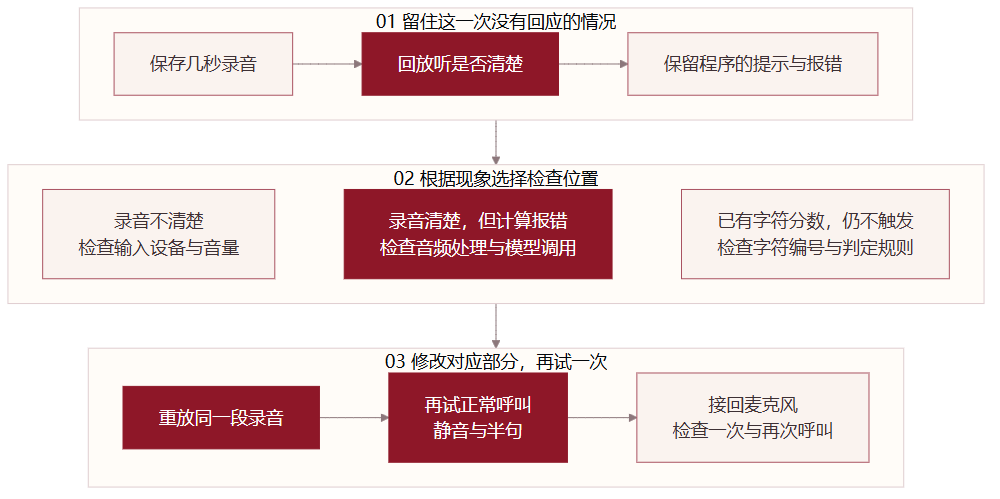

*图15｜先保留一段录音，按实际现象选择检查位置；改动后回到同一输入，再检查正常与边界情况。*

[Mermaid图源](figures/debug.mmd)

### 改好后，再试几次

复测先从原失败样例开始，再加入原本能识别的样例和容易混淆的输入。这样既能看修复是否针对了原问题，也能发现它是否改变了正常行为。对于小团的监听流程，可以把检查安排成下面几次实际操作。

| 怎么试 | 观察什么 | 这一步要排除什么 |
|---|---|---|
| 重放原来没有识别的录音 | 是否完成计算，是否给出预期结果 | 问题只是暂时没出现，实际原因仍未处理 |
| 重放原本能识别的完整呼叫 | 是否仍能正常触发 | 修改破坏了已有的识别行为 |
| 只说一次，随后安静几秒 | 是否只产生一次唤醒事件 | 同一段声音在重叠窗口中被重复判定 |
| 冷却后再说一次完整呼叫 | 是否接收新的有效呼叫 | 去重或冷却把后续交互一起挡住 |
| 输入静音、普通说话和半句“小团” | 是否出现不应有的触发 | 阈值过松或匹配状态留下了不完整进度 |

这些检查用于确认一次改动的行为。完成之后，再按独立数据集和连续负音频评估整体效果，相关指标在下一章展开。

### 需要AI帮助时

遇到语法或库接口问题，我会先自己读完整报错，找到相关调用。仍然没有头绪时，再把报错、必要的代码和预期行为交给AI分析，重点问清楚问题可能出在哪一步、为什么这处修改能够解决它。

对候选改法，我会检查它是否只修正了调用方式，还是连输入数据和判定规则也一起改变了。比如调整函数参数与跳过归一化，都可能让一处报错消失，但跳过归一化会改变模型实际接收到的数据。前者需要核对接口，后者则涉及声学处理，不能按同一种小修改来对待。

采用修改后，我会回到同一段录音，看原问题是否消失，再检查正常样例和边界输入。这样，AI的分析可以帮助缩小排查范围，而最终是否采用、改动是否符合项目逻辑，仍由我结合代码和结果判断。上述过程是在项目实践与本次复盘中进一步整理的工作方法。

<a id="evaluation"></a>

## 15｜评估怎样读，哪些数字可以支持结论

唤醒系统不能只看正样本检出。一个系统如果每小时误触发很多次，即使正样本都能检出，实际使用也会受到明显影响。至少要同时说明：正样本检出率、负样本误报比例、每小时误唤醒次数，以及目标设备上的响应时间。


*图16｜检出率、误报比例、每小时误触发和设备延迟分别回答不同问题。*

[Mermaid图源](figures/evaluation.mmd)

历史评估记录包含164条评分及对应的阈值统计。按上游工具的列定义，阈值0.50对应记录为：检出率1.000000、负样本误报比例0.125874、每小时误唤醒175.626623。这个历史工作点表现为较高检出率，同时仍有较多误触发，阈值与负样本区分是后续调整的重点。

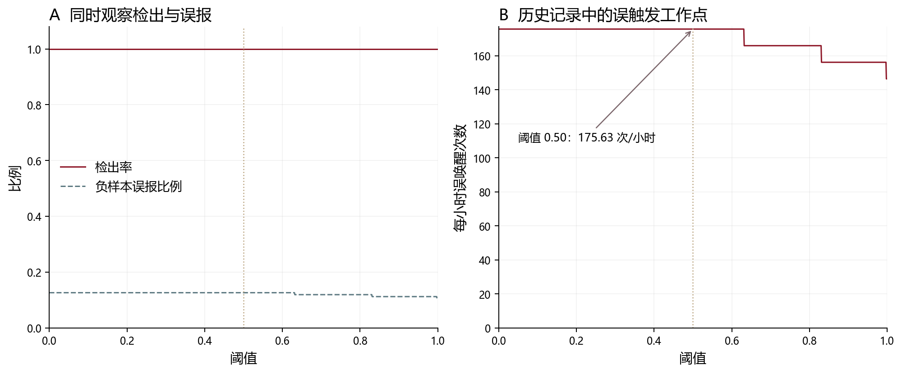

*图17｜历史统计中的阈值工作点，同时观察检出率与误触发频次。*

这组历史统计未附完整的样本划分与时长明细，图中按原统计结果呈现。统计工具在零误报时使用很小的正数代替0以便绘图；接近零的数值需结合实际误触发次数解读。

未来校准应先固定模型、前端与解码路径，在验证集选阈值，再用独立测试集报告结果。不要一边反复查看测试集结果、一边把它当作阈值选择集。连续负音频的时长尤其重要：很短的背景测试无法稳定估计低频误触发事件。

演示视频回答的是“某个现场发生了什么”，评分回答的是“一组指定样本上统计到了什么”，二者相互补充。视频不能替代长时负样本评测，也不应通过单个成功片段推导识别率。

<a id="demo"></a>

## 16｜现场演示：把运行场景放回读者眼前

下面保留了两段现场记录。先看较长的交互过程，再看另一段短片，可以更直观地理解小团所在的使用场景。

### 现场交互 · 1分42秒

[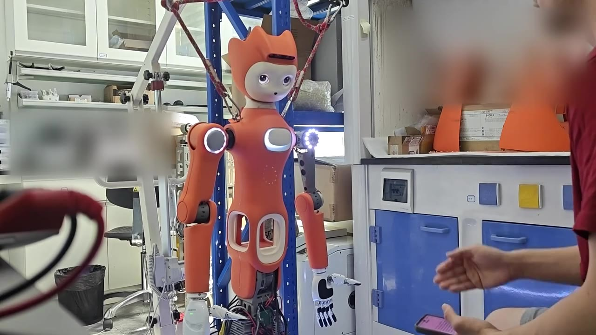](media/demo-interaction.mp4)

[播放现场交互](media/demo-interaction.mp4)

### 另一段现场短片 · 13秒

[](media/demo-short.mp4)

[播放现场短片](media/demo-short.mp4)


阅读时可以将视频与运行时序图对照：注意人开始说话、机器人状态变化和后续交互之间的关系。若要测量延迟，还需要统一音频时间基准与内部事件日志，不能只靠肉眼估计视频中的时间差。

<a id="dictionary"></a>

## 17｜参数手册：查清一个数值如何影响整个系统

下面逐项解释训练配置、关键词配置，以及数据处理、监听与解码中的关键设置。每项给出设置值、作用、调整影响和验证方法，版本差异在对应条目中说明。

需要特别留意三种区别：字段已配置与字段被消费；形状匹配与数值语义一致；理论计算与实际性能。参数搜索既支持变量名，也支持“维度”“误触发”“为什么”等中文描述。


### 运行框架

#### `framework`

**设置值／参考值：** `pytorch`

**含义：** pytorch决定使用的模型框架。

**设置理由：** 沿用训练与权重存储格式。

**调整影响与关联：** 换框架需要转换算子和权重。

**怎样验证：** 检查加载器与权重格式。


### 任务注册

#### `task`

**设置值／参考值：** `keyword-spotting`

**含义：** keyword-spotting表示关键词检测。

**设置理由：** 让框架选择对应任务组件。

**调整影响与关联：** 不是关键词本身，不改变字符ID。

**怎样验证：** 检查注册的模型和训练器。


### 推理入口

#### `pipeline.type`

**设置值／参考值：** `kws-kwsbp`

**含义：** kws-kwsbp是原生资源推理流水线。

**设置理由：** 连接已打包的资源与识别器。

**调整影响与关联：** 它不等同于返回logits的PyTorch计算模块。

**怎样验证：** 检查pipeline返回值和资源路径。


### 网络结构

#### `model.type`

**设置值／参考值：** `speech_kws_fsmn_char_ctc_nearfield`

**含义：** 近场字符CTC模型注册名。

**设置理由：** 使用现成字符级声学建模和训练实现。

**调整影响与关联：** 更换模型类型会改变构造器、前端和权重契约。

**怎样验证：** 确认实例化后的真实子模块。

#### `model.input_dim`

**设置值／参考值：** `400`

**含义：** 每个网络时间步的特征宽度400。

**设置理由：** 80个频带拼接前2帧、当前帧、后2帧，共5帧。

**调整影响与关联：** 修改时需要同步输入层权重形状与CMVN长度。

**怎样验证：** 断言输入最后一维等于400。

#### `model.backbone.type`

**设置值／参考值：** `fsmn`

**含义：** fsmn记忆网络类型。

**设置理由：** 保留上游轻量声学基座以复用权重。

**调整影响与关联：** 换网络需要新的训练和部署验证。

**怎样验证：** 检查层类型与checkpoint键。

#### `model.backbone.input_affine_dim`

**设置值／参考值：** `140`

**含义：** 首个仿射层输出140维。

**设置理由：** 对400维输入先做映射，沿用基座形状。

**调整影响与关联：** 加宽会增加输入层和下一层参数，已有权重不再完整匹配。

**怎样验证：** 比较两层权重矩阵形状。

#### `model.backbone.num_layers`

**设置值／参考值：** `4`

**含义：** 串联4个记忆块。

**设置理由：** 在表达能力与计算开销之间沿用基座取舍。

**调整影响与关联：** 更多层增加计算与上下文跨度，识别效果需要通过相同测试集比较。

**怎样验证：** 计算参数量并做延迟、漏检对照。

#### `model.backbone.linear_dim`

**设置值／参考值：** `250`

**含义：** 记忆块之间传递250维表示。

**设置理由：** 保留上下游层的统一宽度。

**调整影响与关联：** 加宽会增加投影和恢复层参数。

**怎样验证：** 检查每个块输入输出形状。

#### `model.backbone.proj_dim`

**设置值／参考值：** `128`

**含义：** 将250维投影到128维进行记忆滤波。

**设置理由：** 在较低维度存储时间上下文以控制成本。

**调整影响与关联：** 增大提高容量与参数量；固定其他设置时每增1维共增2048个参数。

**怎样验证：** 使用参数实验室核算并检查权重形状。

#### `model.backbone.left_order`

**设置值／参考值：** `10`

**含义：** 左滤波含当前帧在内的10个抽头。

**设置理由：** 覆盖当前与9个过去网络时间步。

**调整影响与关联：** 增大增加历史缓存和计算，不直接增加未来等待；每增1增加512个参数。

**怎样验证：** 用脉冲输入检查历史影响范围。

#### `model.backbone.right_order`

**设置值／参考值：** `2`

**含义：** 每层2个未来抽头。

**设置理由：** 借用后续声音帮助当前帧判别。

**调整影响与关联：** 每增1增加512个参数；4层串联的未来跨度增加120ms。

**怎样验证：** 在固定音频上比较右端边界和输出等待。

#### `model.backbone.left_stride`

**设置值／参考值：** `1`

**含义：** 相邻左抽头间隔1个网络步。

**设置理由：** 连续采样历史信息。

**调整影响与关联：** 增大扩大历史覆盖但变稀疏，滤波权重数量不变。

**怎样验证：** 核对卷积dilation和缓存长度。

#### `model.backbone.right_stride`

**设置值／参考值：** `1`

**含义：** 未来抽头间隔1个网络步。

**设置理由：** 沿用相邻未来帧信息。

**调整影响与关联：** 增大扩大未来跨度，可能增加等待；不增加抽头数量。

**怎样验证：** 计算future span并核对时间戳。

#### `model.backbone.output_affine_dim`

**设置值／参考值：** `140`

**含义：** 分类前映射到140维。

**设置理由：** 压缩到较小表示再输出2599类。

**调整影响与关联：** 加宽主要增大分类头参数。

**怎样验证：** 核对250→140→2599矩阵。

#### `model.output_dim`

**设置值／参考值：** `2599`

**含义：** 2599个字符及特殊符号类别。

**设置理由：** 保留通用字符输出，目标词通过标签和解码定义。

**调整影响与关联：** 改为4类会改变输出头和checkpoint形状，需要重新训练相应参数。

**怎样验证：** 输出最后一维必须为2599。


### 声学前端

#### `preprocessor.filter_conf.max_length`

**设置值／参考值：** `1500`

**含义：** 最大1500个10ms长度单位，约15秒。

**设置理由：** 排除过长录音，控制批内填充和计算。

**调整影响与关联：** 增大允许更长输入，但显存与填充开销可能上升。

**怎样验证：** 按波形时长检查被过滤样本。

#### `preprocessor.filter_conf.min_length`

**设置值／参考值：** `10`

**含义：** 最小10个10ms长度单位，约0.1秒。

**设置理由：** 过滤几乎没有有效语音的输入。

**调整影响与关联：** 提高可能丢弃短词；降低可能引入空白片段。

**怎样验证：** 统计过滤前后条数和短样本。

#### `preprocessor.feature_extraction_conf.feature_type`

**设置值／参考值：** `fbank`

**含义：** fbank对数Mel滤波器组特征。

**设置理由：** 与预训练模型的输入分布一致。

**调整影响与关联：** 改用MFCC或直接频谱时，需要重新匹配输入分布与模型权重。

**怎样验证：** 用相同录音比较前端输出。

#### `preprocessor.feature_extraction_conf.num_mel_bins`

**设置值／参考值：** `80`

**含义：** 每帧80个Mel频带。

**设置理由：** 保留基座的频率表示。

**调整影响与关联：** 改变会联动400维输入和CMVN；频带更多不是自动更准。

**怎样验证：** 检查Fbank形状[T,80]。

#### `preprocessor.feature_extraction_conf.frame_shift`

**设置值／参考值：** `10`

**含义：** 相邻基础帧前进10ms。

**设置理由：** 用重叠窗口观察连续发音。

**调整影响与关联：** 增大降低时间分辨率和帧数；联动降帧后时间步。

**怎样验证：** 核对16k下160采样点步长。

#### `preprocessor.feature_extraction_conf.frame_length`

**设置值／参考值：** `25`

**含义：** 每个分析窗口25ms。

**设置理由：** 在短时间内近似语音平稳。

**调整影响与关联：** 增大提高频率分辨能力但减弱时间定位；改变输入分布。

**怎样验证：** 核对每窗400采样点。

#### `preprocessor.feature_extraction_conf.dither`

**设置值／参考值：** `1.0`

**含义：** 提特征时加入幅度1.0的小随机扰动。

**设置理由：** 在PCM数值尺度下避免纯静音的数值退化。

**调整影响与关联：** 若输入错误地缩放到[-1,1]，同样的1会成为很大扰动。

**怎样验证：** 同时检查波形幅度与Fbank实现。

#### `preprocessor.context_expansion`

**设置值／参考值：** `true`

**含义：** 开启上下文拼接。

**设置理由：** 把相邻基础帧打包给网络。

**调整影响与关联：** 关闭后只有80维，与400维输入层不符。

**怎样验证：** 核对拼接开关与input_dim一起变化。

#### `preprocessor.context_expansion_conf.left`

**设置值／参考值：** `2`

**含义：** 向前取2个基础帧。

**设置理由：** 补充前20ms的局部变化。

**调整影响与关联：** 增加一帧增加80维输入；联动输入层及CMVN。

**怎样验证：** 检查起始处边界复制。

#### `preprocessor.context_expansion_conf.right`

**设置值／参考值：** `2`

**含义：** 向后取2个基础帧。

**设置理由：** 补充后20ms的局部变化。

**调整影响与关联：** 增加一帧增加80维输入和10ms未来跨度。

**怎样验证：** 检查右边界补帧与真实在线等待。

#### `preprocessor.frame_skip`

**设置值／参考值：** `3`

**含义：** 每3个基础帧保留一个拼接结果。

**设置理由：** 将网络时间步从10ms变成30ms以减少计算。

**调整影响与关联：** 改为1时网络帧数约增3倍；时间语义和训练分布同时改变。

**怎样验证：** 训练与部署必须统一抽帧规则。


### 增强与数据

#### `preprocessor.spec_aug`

**设置值／参考值：** `true`

**含义：** 训练特征遮挡开关。

**设置理由：** 让模型减少对局部频带和时间片段的依赖。

**调整影响与关联：** 关闭后减少训练扰动；开启时需要观察短词信息是否被过度遮挡。

**怎样验证：** 训练开、验证与测试关闭并对照。

#### `preprocessor.spec_aug_conf.num_t_mask`

**设置值／参考值：** `2`

**含义：** 每条特征执行2次时间遮挡。

**设置理由：** 制造局部时间缺失的训练扰动。

**调整影响与关联：** 增加会遮住更多有效词信息，短唤醒词尤其敏感。

**怎样验证：** 可视化增强前后特征。

#### `preprocessor.spec_aug_conf.num_f_mask`

**设置值／参考值：** `2`

**含义：** 每条特征执行2次频率遮挡。

**设置理由：** 减少对单一频带的依赖。

**调整影响与关联：** 增加增强强度，也可能损失区分发音的线索。

**怎样验证：** 检查实际遮挡频带与重叠。

#### `preprocessor.spec_aug_conf.max_t`

**设置值／参考值：** `50`

**含义：** 每次时间遮挡长度随机为1到50个基础帧。

**设置理由：** 代码在拼接与降帧前遮挡，50帧对应约500ms步长跨度。

**调整影响与关联：** 增大可能覆盖完整音节；它不是50个30ms网络步。

**怎样验证：** 结合短词长度检查500ms遮挡是否过强。

#### `preprocessor.spec_aug_conf.max_f`

**设置值／参考值：** `30`

**含义：** 每次最多遮挡30个Mel频带。

**设置理由：** 在80维频率表示内作扰动。

**调整影响与关联：** 增大频率信息损失更多，两次遮挡可能重叠。

**怎样验证：** 检查80维输入的实际掩码。

#### `preprocessor.shuffle`

**设置值／参考值：** `true`

**含义：** 训练样本缓冲打乱开关。

**设置理由：** 降低固定输入顺序的影响。

**调整影响与关联：** 关闭可能造成按正负类别顺序训练。

**怎样验证：** 检查每个epoch的样本顺序。

#### `preprocessor.shuffle_conf.shuffle_size`

**设置值／参考值：** `1500`

**含义：** 缓冲1500条后局部打乱。

**设置理由：** 在内存占用和混合程度之间取舍。

**调整影响与关联：** 更大更接近全局打乱，同时增加缓冲占用。

**怎样验证：** 核对内存和类别混合情况。

#### `audio.sample_rate`

**设置值／参考值：** `16000`

**含义：** 每秒16000个采样点。

**设置理由：** 与训练基座和监听设备配置一致。

**调整影响与关联：** 采样率不匹配改变时长与频率解释。

**怎样验证：** 检查WAV头和设备实际采样率。

#### `audio.channels`

**设置值／参考值：** `1`

**含义：** 单声道输入。

**设置理由：** 避免多通道被误当时间序列。

**调整影响与关联：** 立体声需要先确定选通道或混音策略。

**怎样验证：** 检查解码后数组维度。

#### `audio.sample_width`

**设置值／参考值：** `2`

**含义：** 16bit PCM占2字节。

**设置理由：** 生成训练格式pcm_s16le。

**调整影响与关联：** 改变位宽时需要同步解码方式；字节长度与浮点采样点数分别计算。

**怎样验证：** 核对编码器输出。

#### `audio.peak_headroom_db`

**设置值／参考值：** `2.0`

**含义：** 峰值归一化后留2dB余量。

**设置理由：** 给后续叠加留一定幅度空间。

**调整影响与关联：** 不是响度LUFS归一化；叠加仍可能削波。

**怎样验证：** 统计峰值与削波比例。

#### `audio.minimum_ms`

**设置值／参考值：** `1050`

**含义：** 短录音补到1050ms。

**设置理由：** 避免输入过短并随机移动词的位置。

**调整影响与关联：** 更长会增加背景比例，过短不能覆盖目标发音。

**怎样验证：** 检查补齐后长度与语音位置。

#### `audio.padding_position`

**设置值／参考值：** `均匀随机前后分配`

**含义：** 把需要补齐的时间随机分给两侧。

**设置理由：** 避免唤醒词总在固定起点。

**调整影响与关联：** 修改分布改变位置多样性。

**怎样验证：** 检查若干输出波形。

#### `audio.padding_type_weights`

**设置值／参考值：** `[0.2, 0.4, 0.4]`

**含义：** 静音、粉噪声、棕噪声的采样权重。

**设置理由：** 让补齐部分不只有纯静音。

**调整影响与关联：** 权重增大对应底噪更常出现，不是性能权重。

**怎样验证：** 统计生成类型占比。

#### `audio.padding_gain_db`

**设置值／参考值：** `[-50, -35]`

**含义：** 给生成噪声施加的幅度衰减。

**设置理由：** 使补齐背景保持较轻。

**调整影响与关联：** 不是经语音RMS校准的精确信噪比。

**怎样验证：** 计算实际语音与噪声RMS。

#### `audio.noise_layers_weights`

**设置值／参考值：** `[0.2, 0.4, 0.3, 0.1]`

**含义：** 0/1/2/3层噪声的采样权重。

**设置理由：** 保留20%不加噪样本，其余作不同叠加。

**调整影响与关联：** 多层增加变化，也可能削波或盖住语音。

**怎样验证：** 统计层数、峰值和样例可懂度。

#### `audio.noise_duration_ratio`

**设置值／参考值：** `[0.2, 1.0]`

**含义：** 每层噪声长度占录音20%到100%。

**设置理由：** 制造局部与全程干扰。

**调整影响与关联：** 比例提高使噪声覆盖更长。

**怎样验证：** 检查噪声起止位置。

#### `audio.noise_gain_db`

**设置值／参考值：** `[-50, -25]`

**含义：** 生成噪声的增益范围。

**设置理由：** 限制噪声幅度，保持目标语音可辨。

**调整影响与关联：** 该值不是实测SNR；不要照注释写成25—50dB信噪比。

**怎样验证：** 对最终混音分别计算SNR和削波。

#### `audio.noise_peak_scale`

**设置值／参考值：** `0.8`

**含义：** 噪声峰值归一化为16bit范围的80%。

**设置理由：** 先给噪声本身留峰值余量。

**调整影响与关联：** 后续增益与叠加共同决定最终幅度。

**怎样验证：** 检查int16转换前后最大值。

#### `audio.workers`

**设置值／参考值：** `8`

**含义：** 主入口分配8个进程。

**设置理由：** 并行进行CPU解码、FFT和导出。

**调整影响与关联：** 进程多可能争用磁盘；函数名含gpu不代表实际使用GPU。

**怎样验证：** 观察CPU与磁盘吞吐。

#### `data.split_ratio`

**设置值／参考值：** `[0.8, 0.1, 0.1]`

**含义：** 随机分配80%训练、10%验证、其余测试。

**设置理由：** 提供三个用途不同的集合。

**调整影响与关联：** 当前按样本打乱，不保证同说话人或同原始语句隔离。

**怎样验证：** 按来源/说话人分组检查泄漏。

#### `data.seed`

**设置值／参考值：** `42`

**含义：** 划分前固定Python随机种子。

**设置理由：** 便于重复同一次文件顺序下的划分。

**调整影响与关联：** 不自动控制前序NumPy噪声与多进程增强。

**怎样验证：** 记录所有随机源及输入清单。

#### `data.uid_width`

**设置值／参考值：** `4`

**含义：** 样本编号至少四位补零。

**设置理由：** 让列表便于排序与关联。

**调整影响与关联：** 编号排序不保证标签语义正确。

**怎样验证：** 抽查音频内容与转录。


### 训练配置

#### `preprocessor.batch_conf.batch_size`

**设置值／参考值：** `64`

**含义：** 数据处理器每批打包64条录音。

**设置理由：** 从上游256调小，降低每批占用。

**调整影响与关联：** 批小更新更频繁，梯度与填充开销也变化；这里不是token预算。

**怎样验证：** 追踪processor.batch，它实际消费该字段。

#### `train.max_epochs`

**设置值／参考值：** `55`

**含义：** 保存配置上限55，v2脚本改为10。

**设置理由：** 限制训练总轮数，是版本迭代中的显式设置。

**调整影响与关联：** 更大不保证更好；保存的44条元数据跨epoch0—48，不等于55轮完整记录。

**怎样验证：** 以运行配置和epoch记录对应版本。

#### `train.dataloader.workers_per_gpu`

**设置值／参考值：** `4`

**含义：** 训练数据加载使用4个worker。

**设置理由：** 并行解码与预处理，减轻主线程等待。

**调整影响与关联：** 增加可能提高吞吐，也增加CPU/内存竞争。

**怎样验证：** 测CPU、加载等待和batch吞吐。

#### `train.dataloader.prefetch`

**设置值／参考值：** `2`

**含义：** 每个worker预取2批。

**设置理由：** 提前准备后续数据。

**调整影响与关联：** 增大增加预取内存，不必然提速。

**怎样验证：** 观察数据等待与内存峰值。

#### `train.optimizer.lr`

**设置值／参考值：** `0.0001`

**含义：** 初始学习率0.0001。

**设置理由：** 相比上游0.001用较小更新幅度适配目标任务。

**调整影响与关联：** 过大可能破坏已有表征，过小收敛慢；恢复checkpoint元数据可能覆盖初值。

**怎样验证：** 记录每轮实际lr而非只看配置。

#### `train.optimizer.weight_decay`

**设置值／参考值：** `1e-05`

**含义：** Adam的weight decay为0.00001。

**设置理由：** 相比上游0.0001更弱的L2约束。

**调整影响与关联：** 增大时加强参数收缩；训练器使用Adam的weight decay，与AdamW的更新方式有区别。

**怎样验证：** 对照验证损失与误触发，不仅看训练损失。

#### `train.optimizer.grad_clip`

**设置值／参考值：** `5.0`

**含义：** 梯度范数裁剪上限5。

**设置理由：** 限制异常大梯度对一次更新的影响。

**调整影响与关联：** 太小可能持续压制更新，太大保护作用变弱。

**怎样验证：** 记录裁剪前范数和非有限值。

#### `train.optimizer.grad_accum`

**设置值／参考值：** `1`

**含义：** 每1批更新一次，无跨批累积。

**设置理由：** 保持简单直接的更新节奏。

**调整影响与关联：** 增大会改变更新频率及等效批量，需核对损失缩放。

**怎样验证：** 统计backward与optimizer.step次数。

#### `evaluation.dataloader.workers_per_gpu`

**设置值／参考值：** `4`

**含义：** 验证/测试加载4个worker。

**设置理由：** 并行准备评估音频。

**调整影响与关联：** 增大改变资源使用，不改变模型阈值。

**怎样验证：** 检查worker错误和吞吐。

#### `evaluation.dataloader.prefetch`

**设置值／参考值：** `2`

**含义：** 评估每worker预取2批。

**设置理由：** 减少输入等待。

**调整影响与关联：** 增加内存，不改变识别语义。

**怎样验证：** 检查评估内存峰值。


### 配置与调用

#### `dataset.train.name`

**设置值／参考值：** `kws_xiaoyunxiaoyun`

**含义：** 上游数据集的名称或split元数据。

**设置理由：** 项目数据由train_data/cv_data参数给出。

**调整影响与关联：** 此名字不说明项目实际使用了上游样本。

**怎样验证：** 核对传入的wav.scp及转录文件。

#### `dataset.train.split`

**设置值／参考值：** `train`

**含义：** 上游数据集的名称或split元数据。

**设置理由：** 项目数据由train_data/cv_data参数给出。

**调整影响与关联：** 此名字不说明项目实际使用了上游样本。

**怎样验证：** 核对传入的wav.scp及转录文件。

#### `dataset.val.name`

**设置值／参考值：** `kws_xiaoyunxiaoyun`

**含义：** 上游数据集的名称或split元数据。

**设置理由：** 项目数据由train_data/cv_data参数给出。

**调整影响与关联：** 此名字不说明项目实际使用了上游样本。

**怎样验证：** 核对传入的wav.scp及转录文件。

#### `dataset.val.split`

**设置值／参考值：** `val`

**含义：** 上游数据集的名称或split元数据。

**设置理由：** 项目数据由train_data/cv_data参数给出。

**调整影响与关联：** 此名字不说明项目实际使用了上游样本。

**怎样验证：** 核对传入的wav.scp及转录文件。

#### `train.dataloader.batch_size_per_gpu`

**设置值／参考值：** `256`

**含义：** 通用配置字段仍为256。

**设置理由：** 保留了上游字段，但该专用训练器DataLoader设batch_size=None。

**调整影响与关联：** 实际打包数量由preprocessor.batch_conf.batch_size控制。

**怎样验证：** 检查专用训练器DataLoader构造。

#### `train.optimizer.type`

**设置值／参考值：** `Adam`

**含义：** 配置注明Adam。

**设置理由：** 该近场训练器直接构造optim.Adam。

**调整影响与关联：** 只改type字符串不会自动切换优化器。

**怎样验证：** 检查实际构造函数。

#### `train.lr_scheduler.type`

**设置值／参考值：** `ReduceLROnPlateau`

**含义：** 配置写ReduceLROnPlateau。

**设置理由：** 该训练器直接创建同名调度器。

**调整影响与关联：** 更改字符串不会改变已硬编码的构造逻辑。

**怎样验证：** 检查lr_scheduler实际调用。

#### `train.lr_scheduler.mode`

**设置值／参考值：** `min`

**含义：** min表示希望验证损失降低。

**设置理由：** 训练器使用cv_loss驱动调度。

**调整影响与关联：** 配置字段本身未传入，该值在训练器中写死。

**怎样验证：** 核对step(cv_loss)而非分类准确率。

#### `train.lr_scheduler.factor`

**设置值／参考值：** `0.5`

**含义：** 调度时学习率乘0.5。

**设置理由：** 代码硬编码减半策略。

**调整影响与关联：** 改配置字段未必生效；真正改变后会影响降速幅度。

**怎样验证：** 对照逐epoch学习率记录。

#### `train.lr_scheduler.patience`

**设置值／参考值：** `3`

**含义：** 调度耐心值3。

**设置理由：** 代码使用验证损失停滞信号触发降学习率。

**调整影响与关联：** 不要与EarlyStoppingHook的5混淆；这是调度而不是停训。

**怎样验证：** 检查坏epoch计数及PyTorch版本行为。

#### `train.lr_scheduler.min_lr`

**设置值／参考值：** `1e-06`

**含义：** 最小学习率0.000001。

**设置理由：** 防止学习率持续降到极小。

**调整影响与关联：** 该值在训练器中硬编码，配置修改需检查实际消费。

**怎样验证：** 观察学习率是否达到下限。

#### `train.lr_scheduler.threshold`

**设置值／参考值：** `0.01`

**含义：** 损失改善判定阈值0.01。

**设置理由：** 调度器用相对改善规则，未显式改threshold_mode。

**调整影响与关联：** 它控制验证损失的相对改善判定，与关键词检测分数阈值分开使用。

**怎样验证：** 核对调度器默认rel模式及best值。

#### `train.lr_scheduler.verbose`

**设置值／参考值：** `true`

**含义：** 通用配置要求输出调度日志。

**设置理由：** 便于观察学习率变化的意图。

**调整影响与关联：** 该训练器未将此字段传入调度器。

**怎样验证：** 以实际日志输出为准。

#### `train.lr_scheduler_hook.type`

**设置值／参考值：** `PlateauLrSchedulerHook`

**含义：** 通用PlateauLrSchedulerHook类型。

**设置理由：** 属于通用hook配置意图。

**调整影响与关联：** 该训练器走手写循环，没有执行这一hook列表。

**怎样验证：** 检查训练控制流。

#### `train.lr_scheduler_hook.metric_key`

**设置值／参考值：** `avg_loss`

**含义：** 通用hook指标名avg_loss。

**设置理由：** 用于通用训练框架时指定监控项。

**调整影响与关联：** 实际专用循环直接用cv_loss，不按此字段取值。

**怎样验证：** 不要混用avg_loss与cv_loss名称。

#### `train.hooks[0].type`

**设置值／参考值：** `CheckpointHook`

**含义：** CheckpointHook保存模型状态。

**设置理由：** 表达保存、日志、计时、评估或早停意图。

**调整影响与关联：** 这些设置适用于通用hook机制；本文所用近场训练器自行控制训练循环，需在循环中接入相应功能后才会生效。

**怎样验证：** 检查训练循环是否调用hook，而非只检查配置存在。

#### `train.hooks[0].interval`

**设置值／参考值：** `1`

**含义：** 意图每1轮执行一次模型保存。

**设置理由：** 表达保存、日志、计时、评估或早停意图。

**调整影响与关联：** 这些设置适用于通用hook机制；本文所用近场训练器自行控制训练循环，需在循环中接入相应功能后才会生效。

**怎样验证：** 检查训练循环是否调用hook，而非只检查配置存在。

#### `train.hooks[1].type`

**设置值／参考值：** `TextLoggerHook`

**含义：** TextLoggerHook输出训练日志。

**设置理由：** 表达保存、日志、计时、评估或早停意图。

**调整影响与关联：** 这些设置适用于通用hook机制；本文所用近场训练器自行控制训练循环，需在循环中接入相应功能后才会生效。

**怎样验证：** 检查训练循环是否调用hook，而非只检查配置存在。

#### `train.hooks[1].interval`

**设置值／参考值：** `10`

**含义：** 意图每10次迭代输出日志。

**设置理由：** 表达保存、日志、计时、评估或早停意图。

**调整影响与关联：** 这些设置适用于通用hook机制；本文所用近场训练器自行控制训练循环，需在循环中接入相应功能后才会生效。

**怎样验证：** 检查训练循环是否调用hook，而非只检查配置存在。

#### `train.hooks[2].type`

**设置值／参考值：** `IterTimerHook`

**含义：** IterTimerHook记录迭代时间。

**设置理由：** 表达保存、日志、计时、评估或早停意图。

**调整影响与关联：** 这些设置适用于通用hook机制；本文所用近场训练器自行控制训练循环，需在循环中接入相应功能后才会生效。

**怎样验证：** 检查训练循环是否调用hook，而非只检查配置存在。

#### `train.hooks[3].type`

**设置值／参考值：** `EvaluationHook`

**含义：** EvaluationHook发起验证。

**设置理由：** 表达保存、日志、计时、评估或早停意图。

**调整影响与关联：** 这些设置适用于通用hook机制；本文所用近场训练器自行控制训练循环，需在循环中接入相应功能后才会生效。

**怎样验证：** 检查训练循环是否调用hook，而非只检查配置存在。

#### `train.hooks[3].interval`

**设置值／参考值：** `1`

**含义：** 意图每1轮执行一次验证。

**设置理由：** 表达保存、日志、计时、评估或早停意图。

**调整影响与关联：** 这些设置适用于通用hook机制；本文所用近场训练器自行控制训练循环，需在循环中接入相应功能后才会生效。

**怎样验证：** 检查训练循环是否调用hook，而非只检查配置存在。

#### `train.hooks[4].type`

**设置值／参考值：** `EarlyStoppingHook`

**含义：** EarlyStoppingHook表达自动早停策略。

**设置理由：** 表达保存、日志、计时、评估或早停意图。

**调整影响与关联：** 这些设置适用于通用hook机制；本文所用近场训练器自行控制训练循环，需在循环中接入相应功能后才会生效。

**怎样验证：** 检查训练循环是否调用hook，而非只检查配置存在。

#### `train.hooks[4].monitor`

**设置值／参考值：** `cv_loss`

**含义：** 希望早停器观察cv_loss，而非训练损失。

**设置理由：** 表达保存、日志、计时、评估或早停意图。

**调整影响与关联：** 这些设置适用于通用hook机制；本文所用近场训练器自行控制训练循环，需在循环中接入相应功能后才会生效。

**怎样验证：** 检查训练循环是否调用hook，而非只检查配置存在。

#### `train.hooks[4].patience`

**设置值／参考值：** `5`

**含义：** 希望在连续5次评估没有改善时停止。

**设置理由：** 表达保存、日志、计时、评估或早停意图。

**调整影响与关联：** 这些设置适用于通用hook机制；本文所用近场训练器自行控制训练循环，需在循环中接入相应功能后才会生效。

**怎样验证：** 检查训练循环是否调用hook，而非只检查配置存在。

#### `train.hooks[4].mode`

**设置值／参考值：** `min`

**含义：** min表示监控指标越低越好。

**设置理由：** 表达保存、日志、计时、评估或早停意图。

**调整影响与关联：** 这些设置适用于通用hook机制；本文所用近场训练器自行控制训练循环，需在循环中接入相应功能后才会生效。

**怎样验证：** 检查训练循环是否调用hook，而非只检查配置存在。

#### `evaluation.dataloader.batch_size_per_gpu`

**设置值／参考值：** `256`

**含义：** 通用评估批大小字段256。

**设置理由：** 专用评估器沿用预处理器打包方式。

**调整影响与关联：** 评估调用batch_size=64覆盖的是test_conf.batch_conf。

**怎样验证：** 检查真正输入的batch长度。

#### `evaluation.metrics`

**设置值／参考值：** `["audio-noise-metric"]`

**含义：** 保留audio-noise-metric名称。

**设置理由：** 它来自通用配置元数据。

**调整影响与关联：** 该评估入口直接生成评分与DET统计，通用metric字段不参与这一流程。

**怎样验证：** 检查evaluate末端实际函数。


### 训练调用

#### `train.checkpoint`

**设置值／参考值：** `空字符串`

**含义：** 未指定恢复训练checkpoint。

**设置理由：** 该训练器回退到模型仓库train/base.pt。

**调整影响与关联：** 不是随机初始化；传入有效路径时变成恢复/指定权重。

**怎样验证：** 记录实际加载路径与权重指纹。

#### `train.trans_data`

**设置值／参考值：** `训练标签合并文件`

**含义：** 脚本试图只提供训练标签。

**设置理由：** 该转录索引同时供训练和验证清单查询样本标签。

**调整影响与关联：** 缺少验证UID会导致配对问题；标签索引与样本划分应分开理解。

**怎样验证：** 核对两个wav.scp的UID在转录索引中均可找到。

#### `train.cv_trans_data`

**设置值／参考值：** `dev/text`

**含义：** 脚本传入独立验证标签的意图。

**设置理由：** 该版本没有读取此关键字。

**调整影响与关联：** 传入不会自动解决验证转录匹配。

**怎样验证：** 检查kwargs的读取位置与历史版本。

#### `train.need_dump`

**设置值／参考值：** `true`

**含义：** 导出分词和映射后的数据清单。

**设置理由：** 便于检查字符映射与配对。

**调整影响与关联：** 增加用于检查token映射的诊断清单；原始音频与标签仍按样本ID配对。

**怎样验证：** 检查dump文件非空且UID一致。

#### `evaluate.average_num`

**设置值／参考值：** `3`

**含义：** 按验证损失选择3个checkpoint平均。

**设置理由：** 减少单次权重波动，是脚本的模型选择配置。

**调整影响与关联：** 更多模型不必更好，需统一结构及训练轨迹。

**怎样验证：** 核对被选轮次及实际平均结果。

#### `evaluate.threshold`

**设置值／参考值：** `0.5`

**含义：** 评估调用传入的阈值。

**设置理由：** 希望复用关键词配置。

**调整影响与关联：** 该evaluate入口未读取它，而是输出候选再扫描DET阈值。

**怎样验证：** 对比调用参数与统计文件生成逻辑。

#### `evaluate.return_value`

**设置值／参考值：** `None（所查实现）`

**含义：** 函数末尾打印统计文件映射但没有return。

**设置理由：** 评估结果通过评分文件、统计文件和终端输出提供；Python函数返回值另行检查。

**调整影响与关联：** eval_metrics可能是None，不等于没生成评分文件。

**怎样验证：** 分别检查返回值、score与stats文件。


### 运行与状态

#### `runtime.sample_rate`

**设置值／参考值：** `16000`

**含义：** 监听采样率。

**设置理由：** 与目标模型一致。

**调整影响与关联：** 改变需同步重采样、窗口样本数和前端。

**怎样验证：** 记录设备参数与输入长度。

#### `runtime.blocksize`

**设置值／参考值：** `3200（监听）/ 1600（导出）`

**含义：** 在16kHz下分别对应200ms与100ms回调间隔。

**设置理由：** 两个版本采用不同的采集更新频率。

**调整影响与关联：** 更小更新更勤但调度开销更大；与推理窗口长度不同，也不是总识别延迟。

**怎样验证：** 分别核对两个入口的blocksize，并测回调间隔和推理耗时。

#### `runtime.buffer_samples`

**设置值／参考值：** `24000`

**含义：** 保存最近1.5秒浮点音频。

**设置理由：** 覆盖目标短语并维持上下文。

**调整影响与关联：** 更长增加重算量，过短可能截断慢速发音。

**怎样验证：** 用不同语速检查窗口覆盖。

#### `runtime.event_wait_s`

**设置值／参考值：** `0.1`

**含义：** 主循环等待事件最多100ms。

**设置理由：** 允许循环定期检查状态。

**调整影响与关联：** 它不是采样周期；事件多次set可能合并。

**怎样验证：** 记录生产和消费计数。

#### `runtime.fsm_timeout_s`

**设置值／参考值：** `1.5`

**含义：** 部分匹配状态的超时重置门限。

**设置理由：** 避免长时间保留不完整目标序列。

**调整影响与关联：** 该逻辑使用主机墙钟时间，严格限制词间间隔时需要改用音频帧时间。

**怎样验证：** 用固定帧时间戳复核超时语义。

#### `runtime.cooldown_s`

**设置值／参考值：** `1.0`

**含义：** 触发后主循环暂停1秒。

**设置理由：** 减少连续输出同一事件。

**调整影响与关联：** 期间采集回调仍可能继续，睡眠不等于停止采集。

**怎样验证：** 检查回调、缓冲和恢复时序。

#### `runtime.clear_after_trigger`

**设置值／参考值：** `true`

**含义：** 冷却后清空音频缓冲。

**设置理由：** 减少残留语音被再次处理。

**调整影响与关联：** 需要和解码状态、并发访问一起处理。

**怎样验证：** 重复播放同段音频检查去重。

#### `runtime.rms_indicator`

**设置值／参考值：** `0.01`

**含义：** 终端有声标记阈值。

**设置理由：** 帮助观察麦克风是否采到明显声音。

**调整影响与关联：** 当前只控制显示符号，不门控infer调用。

**怎样验证：** 静音输入也跟踪推理次数。

#### `runtime.device`

**设置值／参考值：** `cpu`

**含义：** 部署脚本使用CPU。

**设置理由：** 便于本地推理且无需部署GPU。

**调整影响与关联：** 切换设备时同步迁移模型和张量，并测量采集与推理的总耗时。

**怎样验证：** 测真实设备上的耗时。

#### `runtime.load_strict`

**设置值／参考值：** `false`

**含义：** 允许load_state_dict存在缺失或多余键。

**设置理由：** 尝试兼容不同包装层的权重键。

**调整影响与关联：** 返回缺失/多余键必须核对，否则可能几乎未加载而不报错。

**怎样验证：** 记录missing_keys和unexpected_keys。

#### `runtime.fallback_token_ids`

**设置值／参考值：** `[1463, 1329, 1463, 1329]`

**含义：** 回退逻辑指定的目标字符ID。

**设置理由：** 作为词表解析失败时的回退。

**调整影响与关联：** 词表读取会减1，训练索引应为1462/1328；当前回退存在一位偏移风险。

**怎样验证：** 使用同一tokens文件和读取规则重建映射。

#### `runtime.frontend_export_dim`

**设置值／参考值：** `240`

**含义：** 导出脚本备用前端拼接Mel及一二阶差分。

**设置理由：** 试图构建更丰富的特征。

**调整影响与关联：** 80×3得到240维，与400维输入层不匹配，需要按训练规则调整特征处理。

**怎样验证：** 运行前检查特征形状。

#### `runtime.frontend_server_lfr`

**设置值／参考值：** `[5, 1]`

**含义：** 监听脚本备用前端拼5帧但每帧移动1。

**设置理由：** 把宽度改为400。

**调整影响与关联：** 虽然宽度对上，仍与训练frame_skip=3及Kaldi前端不等价。

**怎样验证：** 同一音频比较前端逐阶段数值。

#### `runtime.exception_return`

**设置值／参考值：** `false`

**含义：** 推理异常直接返回未检测到。

**设置理由：** 使主循环继续运行的容错尝试。

**调整影响与关联：** 错误和真实未唤醒被混在一起，会掩盖故障。

**怎样验证：** 分别统计异常、正常拒绝和触发。


### CTC与词表

#### `ctc.blank_id`

**设置值／参考值：** `0`

**含义：** 无输出符号的索引。

**设置理由：** 用于CTC路径对齐。

**调整影响与关联：** blank表示该帧不输出字符；未知字符和静音检测使用不同的定义。

**怎样验证：** 核对tokens文件ID1减1得到0。

#### `ctc.target_ids`

**设置值／参考值：** `[1462, 1328, 1462, 1328]`

**含义：** 按字符词表及read_token得到的训练索引。

**设置理由：** 保持小—团—小—团顺序。

**调整影响与关联：** 词表换版本时必须重算，不跨模型套用数字。

**怎样验证：** 核对字符→文件ID→网络ID。

#### `decoder.score_beam_size`

**设置值／参考值：** `3`

**含义：** 每帧先保留全词表top3。

**设置理由：** 减少前缀扩展数量。

**调整影响与关联：** 更宽增加开销，可能保留被截掉的目标字符。

**怎样验证：** 在相同音频上对照候选召回。

#### `decoder.path_beam_size`

**设置值／参考值：** `20`

**含义：** 每步保留20条前缀。

**设置理由：** 保留多种时序对齐解释。

**调整影响与关联：** 加宽更耗时，不保证误触发降低。

**怎样验证：** 记录候选数与耗时。

#### `decoder.token_floor`

**设置值／参考值：** `0.05`

**含义：** 帧概率必须严格大于0.05才参与扩展。

**设置理由：** 过滤很弱的候选。

**调整影响与关联：** 不是最终唤醒阈值；提高可能丢失弱发音。

**怎样验证：** 比较候选路径是否被提前剪掉。

#### `decoder.candidate_score`

**设置值／参考值：** `sqrt(product(node_probs))`

**含义：** 关键词节点概率乘积开平方。

**设置理由：** 上游评估器用它构建候选置信分数。

**调整影响与关联：** 不是分类准确率，不与逐帧0.5阈值混用。

**怎样验证：** 手算一个四字符例子并检查实现。

#### `det.score_step`

**设置值／参考值：** `0.001`

**含义：** DET统计从0到1扫描的步长。

**设置理由：** 形成不同阈值的工作点。

**调整影响与关联：** 步长更小增加统计点，不提高原始分数精度。

**怎样验证：** 检查score文件保留的小数位。


### 权重与资源

#### `checkpoint.cmvn_mean_istd`

**设置值／参考值：** `[400, 400]`

**含义：** 保存的均值和逆标准差各400项。

**设置理由：** 将输入映射到训练使用的归一化尺度。

**调整影响与关联：** 这些数值作为buffer保存；改为逐窗口归一化会改变模型的输入分布。

**怎样验证：** 验证加载后实际进入GlobalCMVN.forward。

#### `checkpoint.trainable_parameters`

**设置值／参考值：** `756133`

**含义：** 骨干及输出层可训练参数数量。

**设置理由：** 按实际权重张量形状逐层求和。

**调整影响与关联：** 结构变化后重新计算各层参数，并将归一化buffer另列。

**怎样验证：** 对state_dict排除800项CMVN后求和。


### 关键词配置

#### `keyword.name`

**设置值／参考值：** `小 团 小 团`

**含义：** 目标关键词，按字符加空格。

**设置理由：** 使原生词条与目标字符序列一致。

**调整影响与关联：** 修改目标词需要同步标签、token与评估。

**怎样验证：** 检查规范化后的关键词。

#### `keyword.lm_boost`

**设置值／参考值：** `0.0`

**含义：** 语言分数增益接口。

**设置理由：** 0不加额外语言分数偏置。

**调整影响与关联：** 非零作用位置由原生后端决定。

**怎样验证：** 用同一音频和后端对照。

#### `keyword.am_boost`

**设置值／参考值：** `-0.05`

**含义：** 声学分数增益接口。

**设置理由：** 设置为-0.05，属于原生资源调节。

**调整影响与关联：** 这是原生后端的声学分数调节接口；Python顺序匹配器不读取此项，具体调整效果需在对应后端测试。

**怎样验证：** 核查真实使用的后端。

#### `keyword.min_dur`

**设置值／参考值：** `0.25`

**含义：** 最小候选时长0.25秒。

**设置理由：** 原生词条约束。

**调整影响与关联：** 顺序匹配器没有读取该字段。

**怎样验证：** 检查时长条件是否实际执行。

#### `keyword.max_dur`

**设置值／参考值：** `2.5`

**含义：** 最大候选时长2.5秒。

**设置理由：** 限制原生候选的时间跨度。

**调整影响与关联：** 不等于1.5秒音频缓冲，Python FSM未读取。

**怎样验证：** 按音频帧时间测试慢速长词。

#### `keyword.threshold1`

**设置值／参考值：** `0.5`

**含义：** 关键词阈值0.50。

**设置理由：** 原生候选与Python逐帧筛选均借用此字段。

**调整影响与关联：** 两个解码路径使用不同分数，需要分别选取合适的工作点。

**怎样验证：** 分别校准两条解码路径。

#### `keyword.type`

**设置值／参考值：** `wakeup`

**含义：** 词条类型wakeup。

**设置理由：** 向原生资源声明用途。

**调整影响与关联：** 不会改变网络结构。

**怎样验证：** 检查后端词条加载。

#### `keyword.activation`

**设置值／参考值：** `true`

**含义：** 词条启用标记。

**设置理由：** true表示配置中启用。

**调整影响与关联：** Python脚本直接取首个词条，未使用此开关过滤。

**怎样验证：** 检查实际加载逻辑。

#### `keyword.high_threshold`

**设置值／参考值：** `90.0`

**含义：** 原生附加阈值90。

**设置理由：** 沿用资源字段。

**调整影响与关联：** 该值属于原生接口的附加阈值，不在softmax概率域内；Python判定路径不读取此项。

**怎样验证：** 查原生接口或做黑盒对照。

#### `keyword.is_main`

**设置值／参考值：** `true`

**含义：** 原生主词标记。

**设置理由：** 用于词条角色声明。

**调整影响与关联：** 不意味着多关键词调度已在Python实现。

**怎样验证：** 检查读取字段的代码。

#### `keyword.cc_name`

**设置值／参考值：** `上游附加资源名称（保留）`

**含义：** 原生附加资源引用名称。

**设置理由：** 保留上游资源名称。

**调整影响与关联：** 名字存在不证明附加模型已启用或已适配目标词。

**怎样验证：** 检查资源启用开关与实际文件。


### 运行状态变量

#### `state.state_ptr`

**设置值／参考值：** `0…4`

**含义：** 当前已经匹配的目标字符数。

**设置理由：** 用一个整数记录顺序匹配进度。

**调整影响与关联：** 错误推进或跨窗口重复累计可能造成误触发。

**怎样验证：** 用固定字符序列逐帧检查状态。

#### `state.max_state`

**设置值／参考值：** `4`

**含义：** 目标token序列的长度。

**设置理由：** 小团小团有四个字符。

**调整影响与关联：** 更换关键词时，从token序列长度计算新的终止状态。

**怎样验证：** 断言等于len(keyword_tokens)。

#### `state.last_trigger_time`

**设置值／参考值：** `运行时墙钟时间`

**含义：** 最近一次成功推进字符时记录的主机时间。

**设置理由：** 为部分匹配提供超时判断。

**调整影响与关联：** 墙钟与音频时间不同；整窗处理时多个字符可能记录相近墙钟。

**怎样验证：** 同时记录音频帧索引与主机时间。

#### `state.keyword_tokens`

**设置值／参考值：** `[1463, 1329, 1463, 1329]`

**含义：** 当前回退逻辑产生的期待字符索引。

**设置理由：** 驱动逐字符匹配。

**调整影响与关联：** 映射应采用与训练相同的词表读取规则，本例对应1462/1328。

**怎样验证：** 按真实词表初始化并写映射断言。

#### `state.feats_len`

**设置值／参考值：** `随窗口变化的整数`

**含义：** 提取后特征的有效时间步数。

**设置理由：** 用于需要长度的接口。

**调整影响与关联：** 长度参数与缓存参数具有不同的形状和用途，调用时按接口签名传入。

**怎样验证：** 核对调用签名和维度。

#### `state.best_ids`

**设置值／参考值：** `每帧一个类别索引`

**含义：** 对帧级概率取argmax的结果。

**设置理由：** 简化为每帧最可能字符后做状态推进。

**调整影响与关联：** 丢失其他候选，不等价于保留多条路径的CTC搜索。

**怎样验证：** 构造目标字符不是top1的输入作对照。

#### `state.event`

**设置值／参考值：** `set / clear`

**含义：** 采集与推理之间的二值通知。

**设置理由：** 让主循环等待新音频而不是空转。

**调整影响与关联：** 多次set可能合并；需要逐块处理时，可使用带计数或时间标记的队列。

**怎样验证：** 对比采集回调与处理次数。

#### `state.running`

**设置值／参考值：** `True / False`

**含义：** 监听循环是否继续。

**设置理由：** 控制启动、退出和资源释放。

**调整影响与关联：** 只改标志不自动关闭底层设备流。

**怎样验证：** 检查退出路径是否释放音频流。


### 原生资源接口

#### `native.KwsrRecognizer::debug_mode`

**设置值／参考值：** `false`

**含义：** 调试开关。

**设置理由：** 正常部署关闭调试信息，避免日志负担。

**调整影响与关联：** 开启主要增加可观测性和I/O；不应改变任务定义。

**怎样验证：** 在匹配的原生资源与后端中做单项对照，观察识别结果、耗时及资源使用。

#### `native.KwsrRecognizer::dump_feat_mode`

**设置值／参考值：** `false`

**含义：** 是否转储声学特征。

**设置理由：** 默认关闭，避免额外磁盘占用。

**调整影响与关联：** 排查前端差异时可用；开启前估计文件量。

**怎样验证：** 在匹配的原生资源与后端中做单项对照，观察识别结果、耗时及资源使用。

#### `native.KwsrRecognizer::log_file`

**设置值／参考值：** `kws.log`

**含义：** 原生日志文件路径。

**设置理由：** 将诊断输出定位到文件。

**调整影响与关联：** 更改路径影响日志保存位置；不是模型性能参数。

**怎样验证：** 在匹配的原生资源与后端中做单项对照，观察识别结果、耗时及资源使用。

#### `native.KwsrRecognizer::reset_frames`

**设置值／参考值：** `6000`

**含义：** 原生配置中的重置帧数。

**设置理由：** 用于运行状态管理的接口项。

**调整影响与关联：** 重置时间取决于后端的帧计数规则，需要结合实际输入步长与运行行为换算。

**怎样验证：** 在匹配的原生资源与后端中做单项对照，观察识别结果、耗时及资源使用。

#### `native.KwsrRecognizer::am_score_file`

**设置值／参考值：** ``

**含义：** 声学分数输出文件接口。

**设置理由：** 空值不指定分数导出文件。

**调整影响与关联：** 是否导出及格式由原生实现决定；不等同最终检测分数。

**怎样验证：** 在匹配的原生资源与后端中做单项对照，观察识别结果、耗时及资源使用。

#### `native.KwsrRecognizer::lexicon_file`

**设置值／参考值：** `kwsr.lex`

**含义：** 词典资源路径。

**设置理由：** 将词条与后端使用的单元关联。

**调整影响与关联：** 必须与phone table和网络类别保持一致。

**怎样验证：** 在匹配的原生资源与后端中做单项对照，观察识别结果、耗时及资源使用。

#### `native.KwsrRecognizer::phone_table_file`

**设置值／参考值：** `kwsr.phn`

**含义：** 原生输出单元表路径。

**设置理由：** 决定网络输出ID的资源侧含义。

**调整影响与关联：** 改顺序可能语义错位，即使文件仍能打开。

**怎样验证：** 在匹配的原生资源与后端中做单项对照，观察识别结果、耗时及资源使用。

#### `native.KwsrRecognizer::fillers_file`

**设置值／参考值：** `kwsr.gbg`

**含义：** 填充/非目标词资源路径。

**设置理由：** 组织背景或非关键词路径的配置资源。

**调整影响与关联：** 改变背景路径资源会影响搜索过程，需与负样本评估配合检查。

**怎样验证：** 在匹配的原生资源与后端中做单项对照，观察识别结果、耗时及资源使用。

#### `native.KwsrRecognizer::build_graph_acoustic_scale`

**设置值／参考值：** `0.1`

**含义：** 原生声学分数缩放接口。

**设置理由：** 协调原生图搜索中的分数尺度。

**调整影响与关联：** 不是音频音量；改变可能影响候选排序与阈值。

**怎样验证：** 在匹配的原生资源与后端中做单项对照，观察识别结果、耗时及资源使用。

#### `native.KwsrRecognizer::fillers_cdphone_ext`

**设置值／参考值：** `NO_EXT`

**含义：** 填充路径上下文相关单元扩展方式。

**设置理由：** NO_EXT表示该接口关闭扩展。

**调整影响与关联：** 开启扩展时需要配套的单元表、词典与后端支持。

**怎样验证：** 在匹配的原生资源与后端中做单项对照，观察识别结果、耗时及资源使用。

#### `native.KwsrRecognizer::keyword_cdphone_ext_opt`

**设置值／参考值：** `NO_EXT`

**含义：** 关键词路径上下文扩展选项。

**设置理由：** 默认NO_EXT，沿用模型资源约定。

**调整影响与关联：** 更改需后端文档与资源支持。

**怎样验证：** 在匹配的原生资源与后端中做单项对照，观察识别结果、耗时及资源使用。

#### `native.KwsrRecognizer::am_file`

**设置值／参考值：** `kwsr`

**含义：** 声学模型资源前缀。

**设置理由：** kwsr用于关联相应模型文件。

**调整影响与关联：** 必须与实际资源文件名配套。

**怎样验证：** 在匹配的原生资源与后端中做单项对照，观察识别结果、耗时及资源使用。

#### `native.KwsrRecognizer::am_nn_file`

**设置值／参考值：** `kwsr`

**含义：** 神经网络资源前缀。

**设置理由：** 将运行器指向当前网络资源。

**调整影响与关联：** 不要混用task1和task2的输出维度。

**怎样验证：** 在匹配的原生资源与后端中做单项对照，观察识别结果、耗时及资源使用。

#### `native.KwsrRecognizer::am_nn_format`

**设置值／参考值：** `kaldi_nnet1`

**含义：** 原生网络格式。

**设置理由：** 匹配导出工具与加载器。

**调整影响与关联：** 换格式需相应转换和运行后端支持。

**怎样验证：** 在匹配的原生资源与后端中做单项对照，观察识别结果、耗时及资源使用。

#### `native.KwsrRecognizer::am_nn_quant`

**设置值／参考值：** `16bit`

**含义：** 原生配置声明的网络精度类型。

**设置理由：** 降低部署资源开销的工程选择。

**调整影响与关联：** 位宽影响资源体积与计算方式；具体数值格式由转换工具定义，运行速度通过设备测试确定。

**怎样验证：** 在匹配的原生资源与后端中做单项对照，观察识别结果、耗时及资源使用。

#### `native.KwsrRecognizer::am_use_logsoftmax`

**设置值／参考值：** `false`

**含义：** 是否使用log-softmax输出的后端约定。

**设置理由：** false与当前导出Softmax网络的接口配套。

**调整影响与关联：** 切换概率/对数域需同时调整后端分数计算。

**怎样验证：** 在匹配的原生资源与后端中做单项对照，观察识别结果、耗时及资源使用。

#### `native.KwsrRecognizer::input_batch_size`

**设置值／参考值：** `1`

**含义：** 原生接口输入批处理大小。

**设置理由：** 1是资源中给定的小批处理设置。

**调整影响与关联：** 增大可能改变吞吐、等待及内存，精确行为需目标后端验证。

**怎样验证：** 在匹配的原生资源与后端中做单项对照，观察识别结果、耗时及资源使用。

#### `native.KwsrRecognizer::output_batch_size`

**设置值／参考值：** `1`

**含义：** 原生接口输出批处理大小。

**设置理由：** 1对应当前输出组织。

**调整影响与关联：** 控制原生接口的输出组织，与训练批大小和词表类别数分别设置。

**怎样验证：** 在匹配的原生资源与后端中做单项对照，观察识别结果、耗时及资源使用。

#### `native.KwsrRecognizer::lazy_evaluation`

**设置值／参考值：** `false`

**含义：** 原生延迟计算策略开关。

**设置理由：** 当前false不启用该策略。

**调整影响与关联：** 开启后由原生后端调整执行时机，收益需要通过耗时与内存对照测试确定。

**怎样验证：** 在匹配的原生资源与后端中做单项对照，观察识别结果、耗时及资源使用。

#### `native.KwsrRecognizer::global_beam`

**设置值／参考值：** `5.0`

**含义：** 原生配置中的搜索裁剪项。

**设置理由：** 属于后端搜索策略接口。

**调整影响与关联：** 搜索宽度变化会影响候选保留、开销与识别结果，沿用匹配资源后逐项对照调整。

**怎样验证：** 在匹配的原生资源与后端中做单项对照，观察识别结果、耗时及资源使用。

#### `native.KwsrRecognizer::gbg_beam`

**设置值／参考值：** `0.5`

**含义：** 原生配置中的搜索裁剪项。

**设置理由：** 属于后端搜索策略接口。

**调整影响与关联：** 背景路径的搜索设置需要与关键词路径配合，通过误触发及耗时对照选择。

**怎样验证：** 在匹配的原生资源与后端中做单项对照，观察识别结果、耗时及资源使用。

#### `native.KwsrRecognizer::acoustic_scale`

**设置值／参考值：** `0.1`

**含义：** 原生声学分数缩放接口。

**设置理由：** 协调原生图搜索中的分数尺度。

**调整影响与关联：** 不是音频音量；改变可能影响候选排序与阈值。

**怎样验证：** 在匹配的原生资源与后端中做单项对照，观察识别结果、耗时及资源使用。

#### `native.KwsrRecognizer::hash_table_size`

**设置值／参考值：** `1024`

**含义：** 原生搜索哈希表容量参数。

**设置理由：** 1024为资源给定的容器设置。

**调整影响与关联：** 可能影响搜索数据结构的内存和扩展，非网络参数量。

**怎样验证：** 在匹配的原生资源与后端中做单项对照，观察识别结果、耗时及资源使用。

#### `native.KwsrRecognizer::hash_ratio`

**设置值／参考值：** `2.0`

**含义：** 原生哈希容器相关比例。

**设置理由：** 2.0是后端资源设置。

**调整影响与关联：** 属于搜索容器配置；一般保留后端默认值，在明确出现容量或性能问题时再调整。

**怎样验证：** 在匹配的原生资源与后端中做单项对照，观察识别结果、耗时及资源使用。

#### `native.KwsrRecognizer::token_pool_realloc`

**设置值／参考值：** `1024`

**含义：** 原生搜索token内存池扩展参数。

**设置理由：** 1024是内存管理配置。

**调整影响与关联：** 不是词表类别数，也不是关键词长度。

**怎样验证：** 在匹配的原生资源与后端中做单项对照，观察识别结果、耗时及资源使用。

#### `native.KwsrRecognizer::default_wuw_threshold1`

**设置值／参考值：** `0.01`

**含义：** 没有词级阈值覆盖时的默认唤醒阈值接口。

**设置理由：** 0.01为资源缺省值；实际关键词还提供threshold1。

**调整影响与关联：** 词级阈值可能覆盖缺省值，选工作点前先确认最终生效的配置。

**怎样验证：** 在匹配的原生资源与后端中做单项对照，观察识别结果、耗时及资源使用。

#### `native.KwsrRecognizer::default_wuw_threshold2`

**设置值／参考值：** `0.0`

**含义：** 第二缺省阈值接口。

**设置理由：** 0.0为当前资源默认。

**调整影响与关联：** 属于后端的第二缺省阈值接口，具体用途随识别实现而定，调整时比较实际输出。

**怎样验证：** 在匹配的原生资源与后端中做单项对照，观察识别结果、耗时及资源使用。

#### `native.KwsrRecognizer::kws_mode`

**设置值／参考值：** `true`

**含义：** 原生识别器的关键词检测模式。

**设置理由：** true选择KWS用途。

**调整影响与关联：** 关闭可能切换识别语义，需要对应后端支持。

**怎样验证：** 在匹配的原生资源与后端中做单项对照，观察识别结果、耗时及资源使用。

#### `native.KwsrRecognizer::prefix_kws`

**设置值／参考值：** `false`

**含义：** 原生前缀唤醒相关模式开关。

**设置理由：** 当前false，沿用现有资源。

**调整影响与关联：** 它是原生模式开关，与decoder_type选择ctc-prefix解码器属于不同配置层。

**怎样验证：** 在匹配的原生资源与后端中做单项对照，观察识别结果、耗时及资源使用。

#### `native.KwsrRecognizer::num_history_frames`

**设置值／参考值：** `0`

**含义：** 原生额外历史帧设置。

**设置理由：** 0为此资源给定值。

**调整影响与关联：** 此项管理后端额外历史帧；网络自身的FSMN记忆由滤波抽头控制。

**怎样验证：** 在匹配的原生资源与后端中做单项对照，观察识别结果、耗时及资源使用。

#### `native.KwsrRecognizer::am_phones_exc`

**设置值／参考值：** `W_*:rr*:lv*`

**含义：** 声学单元排除模式字符串。

**设置理由：** 为原生资源指定排除规则。

**调整影响与关联：** 通配模式含义属于该资源契约，改动须核查实际单元表。

**怎样验证：** 在匹配的原生资源与后端中做单项对照，观察识别结果、耗时及资源使用。

#### `native.KwsrRecognizer::use_cc`

**设置值／参考值：** `false`

**含义：** 是否启用附加cc模块。

**设置理由：** 当前资源显式关闭。

**调整影响与关联：** 关闭时主识别流程不使用该附加模块；开启时需要对应资源和接口支持。

**怎样验证：** 在匹配的原生资源与后端中做单项对照，观察识别结果、耗时及资源使用。

#### `native.KwsrRecognizer::cc_model`

**设置值／参考值：** `scp:kwsr.ccl`

**含义：** 附加cc模块模型路径。

**设置理由：** 资源存在但use_cc=false时不应宣称参与判定。

**调整影响与关联：** 启用需完整对应模型和接口验收。

**怎样验证：** 在匹配的原生资源与后端中做单项对照，观察识别结果、耗时及资源使用。

#### `native.KwsrRecognizer::cc_nn_quant`

**设置值／参考值：** `32bit`

**含义：** cc模块精度声明。

**设置理由：** 32bit对应附加模块的资源接口。

**调整影响与关联：** use_cc=false时不是主网络的精度设置。

**怎样验证：** 在匹配的原生资源与后端中做单项对照，观察识别结果、耗时及资源使用。

#### `native.KwsrRecognizer::sil_am_boost`

**设置值／参考值：** `0.0`

**含义：** 静音声学分数增益接口。

**设置理由：** 0.0表示不给该接口额外增益。

**调整影响与关联：** 不是录音静音检测阈值。

**怎样验证：** 在匹配的原生资源与后端中做单项对照，观察识别结果、耗时及资源使用。

#### `native.Decimate::begin-frame`

**设置值／参考值：** `0`

**含义：** 降帧起始相位。

**设置理由：** 0从起始帧开始抽取。

**调整影响与关联：** 改相位改变与输入帧的对齐，不会改变词表。

**怎样验证：** 在匹配的原生资源与后端中做单项对照，观察识别结果、耗时及资源使用。

#### `native.output-type`

**设置值／参考值：** `FE_LOGFB+P+Dec3`

**含义：** 声学特征及降帧类型串。

**设置理由：** FE_LOGFB+P+Dec3对应对数滤波特征及三倍降帧约定。

**调整影响与关联：** 换类型要同步模型输入维度和CMVN。

**怎样验证：** 在匹配的原生资源与后端中做单项对照，观察识别结果、耗时及资源使用。

#### `native.input-type`

**设置值／参考值：** `FE_16K_16BIT_PCM`

**含义：** 输入字节格式。

**设置理由：** FE_16K_16BIT_PCM要求16k、16bit PCM。

**调整影响与关联：** 错误采样率、位宽或字节序会导致错误声音解释。

**怎样验证：** 在匹配的原生资源与后端中做单项对照，观察识别结果、耗时及资源使用。

#### `native.Waveform2Filterbank::dither`

**设置值／参考值：** `1`

**含义：** 原生前端微小随机扰动。

**设置理由：** 资源给定1，与其训练前端保持一致。

**调整影响与关联：** 扰动幅度依赖波形数值尺度，PCM域与归一化浮点域需要分别处理。

**怎样验证：** 在匹配的原生资源与后端中做单项对照，观察识别结果、耗时及资源使用。

#### `native.Waveform2Filterbank::htk-compat`

**设置值／参考值：** `false`

**含义：** HTK兼容特征约定。

**设置理由：** false采用当前Kaldi式资源约定。

**调整影响与关联：** 开启可能改变能量/特征定义，须与训练一致。

**怎样验证：** 在匹配的原生资源与后端中做单项对照，观察识别结果、耗时及资源使用。

#### `native.Waveform2Filterbank::window-type`

**设置值／参考值：** `hamming`

**含义：** 原生分帧窗函数。

**设置理由：** hamming与公开前端约定一致。

**调整影响与关联：** 替换会改变频谱分布。

**怎样验证：** 在匹配的原生资源与后端中做单项对照，观察识别结果、耗时及资源使用。

#### `native.Waveform2Filterbank::num-mel-bins`

**设置值／参考值：** `80`

**含义：** 原生资源Mel维度。

**设置理由：** 原生资源使用80维，与模型声学输入频带数一致。

**调整影响与关联：** 改频带数需同步上下文拼接、归一化与网络输入。

**怎样验证：** 在匹配的原生资源与后端中做单项对照，观察识别结果、耗时及资源使用。

#### `native.ContextExpansion::minus`

**设置值／参考值：** `2`

**含义：** 上下文拼接左帧数。

**设置理由：** 左2帧与当前及右2帧组成80×5=400维输入。

**调整影响与关联：** 增加会改变输入宽度和历史跨度，需要同步权重与归一化。

**怎样验证：** 在匹配的原生资源与后端中做单项对照，观察识别结果、耗时及资源使用。

#### `native.ContextExpansion::plus`

**设置值／参考值：** `2`

**含义：** 上下文拼接右帧数。

**设置理由：** 右2帧提供基础帧级未来信息，与400维输入配置配套。

**调整影响与关联：** 增加会改变输入宽度与未来等待，需要重做一致性检查。

**怎样验证：** 在匹配的原生资源与后端中做单项对照，观察识别结果、耗时及资源使用。

#### `native.KwsrRecognizer::am_nn_type`

**设置值／参考值：** `kaldi`

**含义：** 神经网络类型接口。

**设置理由：** kaldi选择对应网络格式读取路径。

**调整影响与关联：** 决定网络资源的读取格式，训练框架由训练流程另行定义。

**怎样验证：** 在匹配的原生资源与后端中做单项对照，观察识别结果、耗时及资源使用。

#### `native.KwsrRecognizer::decoder_type`

**设置值／参考值：** `ctc-prefix`

**含义：** 选择原生CTC前缀解码器。

**设置理由：** 与逐帧CTC输出对接。

**调整影响与关联：** 不意味着它与Python解码逐行相同。

**怎样验证：** 在匹配的原生资源与后端中做单项对照，观察识别结果、耗时及资源使用。

#### `native.CtcWinDecoder::ctc_print_score`

**设置值／参考值：** `false`

**含义：** 对应解码器是否打印分数。

**设置理由：** false减少输出。

**调整影响与关联：** 调试信息不等于改变检测阈值。

**怎样验证：** 在匹配的原生资源与后端中做单项对照，观察识别结果、耗时及资源使用。

#### `native.CtcWinDecoder::ctc_shift_frame`

**设置值／参考值：** `10`

**含义：** 窗口式CTC解码器的窗口移动设置。

**设置理由：** 当前选中的是ctc-prefix，不应直接把窗口分支设置写为生效。

**调整影响与关联：** 仅在对应解码器被选中时解释影响。

**怎样验证：** 在匹配的原生资源与后端中做单项对照，观察识别结果、耗时及资源使用。

#### `native.CtcWinDecoder::ctc_frame_len`

**设置值／参考值：** `70`

**含义：** 窗口式CTC解码器的窗口长度设置。

**设置理由：** 70属于窗口解码分支配置。

**调整影响与关联：** 只在对应窗口解码器被选中时解释其影响；ctc-prefix路径使用自身的判定逻辑。

**怎样验证：** 在匹配的原生资源与后端中做单项对照，观察识别结果、耗时及资源使用。

#### `native.CtcPrefixDecoder::ctc_print_score`

**设置值／参考值：** `false`

**含义：** 对应解码器是否打印分数。

**设置理由：** false减少输出。

**调整影响与关联：** 调试信息不等于改变检测阈值。

**怎样验证：** 在匹配的原生资源与后端中做单项对照，观察识别结果、耗时及资源使用。

#### `native.CtcPrefixDecoder::ctc_prefix_score_beam`

**设置值／参考值：** `3`

**含义：** 前缀解码每帧候选宽度。

**设置理由：** 3减少类别扩展数量。

**调整影响与关联：** 增大会增加搜索开销，需实际评测。

**怎样验证：** 在匹配的原生资源与后端中做单项对照，观察识别结果、耗时及资源使用。

#### `native.CtcPrefixDecoder::ctc_prefix_path_beam`

**设置值／参考值：** `20`

**含义：** 前缀解码保留路径宽度。

**设置理由：** 20保留多种对齐候选。

**调整影响与关联：** 增大搜索更宽但更耗时，不保证误报下降。

**怎样验证：** 在匹配的原生资源与后端中做单项对照，观察识别结果、耗时及资源使用。

#### `native.CtcPrefixDecoder::ctc_prefix_use_filter`

**设置值／参考值：** `true`

**含义：** 前缀解码过滤策略开关。

**设置理由：** true启用原生过滤接口。

**调整影响与关联：** 控制原生前缀解码过滤策略，调整时通过候选输出和识别结果对照验证。

**怎样验证：** 在匹配的原生资源与后端中做单项对照，观察识别结果、耗时及资源使用。


<a id="sources"></a>

## 18｜工作总结、后续完善与实现来源

这项工作的核心是将预训练声学能力适配到“小团小团”及本地运行流程：把数据整理成训练器能够消费的形式，组织微调与评估入口，整理部署资源，处理模型接口和音频输入，再用状态逻辑将帧级输出变成可使用的事件。它涉及算法理解，也涉及文件、张量、接口、并发和异常的工程组织。

后续完善按依赖关系推进：先核对词表索引与前端一致性，再确认真实计算模块和权重加载；随后验证时间状态与重复窗口处理，最后在固定链路上重新校准阈值、测量设备延迟和长时误触发。这样的顺序能避免在输入或接口尚未正确时，通过反复训练掩盖根因。

### 来源与复用说明

- **模型基座**：ModelScope 的 [字符级近场 cFSMN 唤醒模型](https://modelscope.cn/models/iic/speech_charctc_kws_phone-xiaoyun)。上游仓库标识用于准确定位预训练资产，项目目标词为“小团小团”。
- **框架与算法参考**：ModelScope 固定提交 `958c3f7da68b700cc671134e267c356a2444398b`，对应 [近场训练器](https://github.com/modelscope/modelscope/blob/958c3f7da68b700cc671134e267c356a2444398b/modelscope/trainers/audio/kws_nearfield_trainer.py)、[特征处理器](https://github.com/modelscope/modelscope/blob/958c3f7da68b700cc671134e267c356a2444398b/modelscope/msdatasets/dataset_cls/custom_datasets/audio/kws_nearfield_processor.py)、[模型构造与前向](https://github.com/modelscope/modelscope/blob/958c3f7da68b700cc671134e267c356a2444398b/modelscope/models/audio/kws/nearfield/model.py)、[CTC与评估执行](https://github.com/modelscope/modelscope/blob/958c3f7da68b700cc671134e267c356a2444398b/modelscope/trainers/audio/kws_utils/batch_utils.py)、[词表读取](https://github.com/modelscope/modelscope/blob/958c3f7da68b700cc671134e267c356a2444398b/modelscope/trainers/audio/kws_utils/file_utils.py)、[DET统计](https://github.com/modelscope/modelscope/blob/958c3f7da68b700cc671134e267c356a2444398b/modelscope/trainers/audio/kws_utils/det_utils.py)。相关接口分析以该版本为参考。
- **辅助语音生成组件**：[CosyVoice](https://github.com/FunAudioLLM/CosyVoice)。辅助语音生成工具采用的基础组件。
- **调试方法**：[Google SRE：Effective Troubleshooting](https://sre.google/sre-book/effective-troubleshooting/)。吸收假设检验与分层观察的思路，结合本项目组织具体检查步骤。
- **项目记录**：技术方案、参数设置、训练与评估记录，以及对应的结论分析。
- **视觉主题**：沿用既有山东大学校园与校徽素材；深红色为页面屏幕主题。文档是个人项目技术说明。

结构计数、历史记录和进一步完善的方法分别在相应位置说明，方便读者从证据理解设计，也方便后续工作沿着同一条技术路线继续推进。
